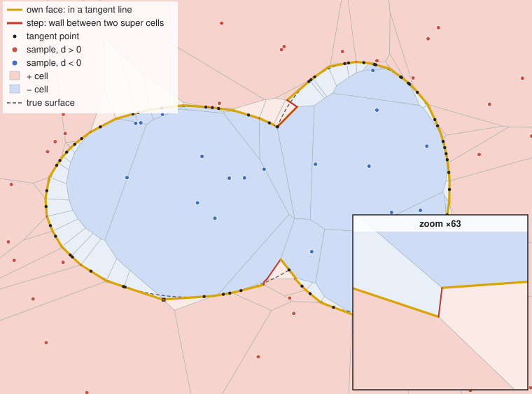
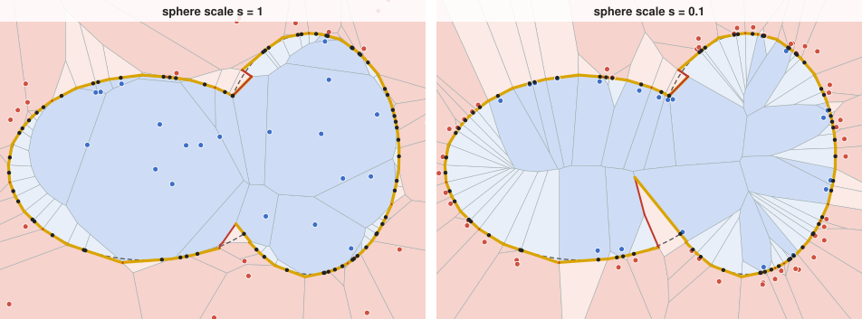
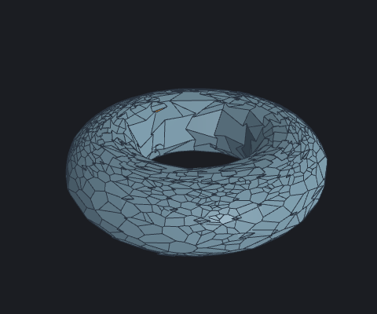
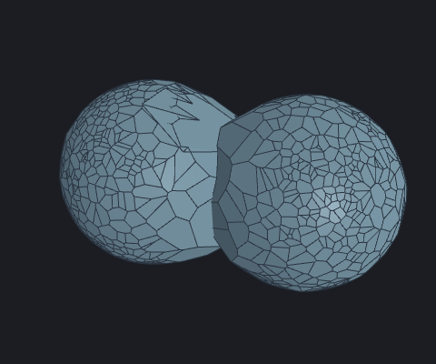
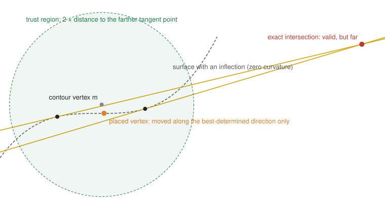
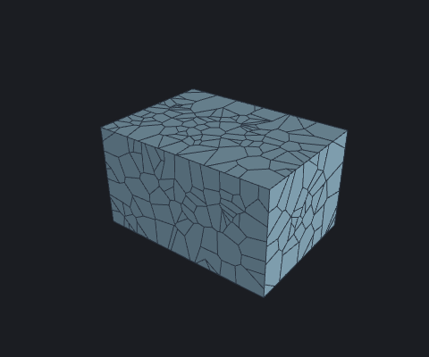

# Recovering a surface from the power contour

This note describes the structure of the power contour of samples plus tangent points, and three ways to turn it into a surface with one face per tangent point: *Contract contour regions*, *Extend own faces* and *Triangulate step patches*. Code: `recover.js` (`recoverSurface`, `extendOwnFaces`, `triangulatePatches`, `qefTruncated`). A third method, *Clip tangent planes*, is described in `ARCHITECTURE.md`.

## Setup

For each sample `p_a` with SDF value `d_a ≠ 0`:

- the **tangent point** `t_a` is its closest surface point, and `n_a = (p_a − t_a) / d_a` is the outward unit normal there (the SDF gradient);
- the **tangent plane** is `P_a = { x : f_a(x) = 0 }` with `f_a(x) = n_a · (x − t_a)`;
- the sample is a site with weight `d_a²` (a sphere of radius `|d_a|` that touches the surface at `t_a`) and sign `sign(d_a)`;
- the tangent point is a site with weight 0 and the opposite sign.

The trusted data are `t_a`, `n_a`, and the sign of `d_a`. The power contour is the set of faces between a `+` cell and a `−` cell. Each site has an *owner*: the sample it comes from.

The figures in 2D are computed with the same constructions in the plane (a 2D power diagram of samples and tangent points on the union of two ellipses, which has two concave creases). In 2D a tangent plane is a line, a face is a segment, and a vertex is where two lines meet. The 3D figures are screenshots of the viewer. To regenerate them: `node figures/make2d.js` and `bash figures/shoot3d.sh`.


*One sample `p` (sphere of radius `d`) and its tangent point `t`. Their two cells together (outlined) are the super cell `C`; the boundary between them is the own face `F`, which lies exactly in the tangent line (dotted). Note that `p` is not inside the outlined cell: neighbors' larger spheres take that space, as is common in power diagrams.*

## Structure

**1. The bisector of a sample and its tangent point is the tangent plane.** With `p = t + d n`:

```
π_p(x) − π_t(x) = |x − p|² − d² − |x − t|² = −2 d · n·(x − t) = −2 d · f(x).
```

This holds for any sphere tangent to `P_a` at `t_a`, whatever its radius. That is what makes the sphere scale below possible.

**2. Super cells and own faces.** The two cells of owner `a` together form a *super cell* `C_a`. Inside `C_a`, the boundary between them is exactly where their powers are equal, which is `P_a`. So the **own face** is

```
F_a = P_a ∩ C_a,
```

a convex polygon lying exactly in the tangent plane. There is exactly one per tangent point, and it contains `t_a`: at `t_a` both sites have power 0, and every other site has positive power (for an exact SDF, `t_a` is outside every other sample's sphere).

**3. Steps.** Every other contour face lies on a wall between two super cells `C_a` and `C_b`. On the wall, `P_a` and `P_b` cut two different lines; the step is the region between them (a double wedge with its apex where the line `P_a ∩ P_b` crosses the wall). Steps exist because neighboring tangent planes do not meet on the wall.



*2D, `s = 1`: the contour (thick) is own faces (gold) joined by steps (red). In 2D, steps on smooth parts are tiny (median length `10⁻⁴` against `0.08` for own faces; inset, ×63); the visible ones are at the concave creases, where the two sides' tangent lines meet inside the shape.*


*3D, torus, 300 samples, `s = 1`, sliced at `z = 0`, colored by face type: own faces (green, each in its tangent plane), steps (purple: sample – other tangent point), and sample – sample faces (gold). In 3D a step is a polygon on a wall between super cells, and steps take a visible share of the contour.*

**4. Own faces never share an edge** (generically). A corner of `F_a` is a power-diagram vertex with four cells, two of which belong to `a`, so it touches at most three owners. An edge of `F_a` has a third cell from another owner, so across it is a step. The exception is a degenerate configuration: on a sphere, by symmetry, `P_a ∩ P_b` lies exactly in the bisector, so there are no steps and the contour already is the tangent-plane polyhedron.

**5. The goal.** Eliminate the steps: extend each own face in its plane until it meets its neighbors' planes. The result has one face per tangent point, edges on the lines `P_a ∩ P_b`, and vertices at the points `P_a ∩ P_b ∩ P_c`. Equivalently, move the walls between super cells so they contain the lines `P_a ∩ P_b`. Then the function `F(x) = f_{a(x)}(x)`, where `a(x)` is the super cell containing `x`, becomes continuous, and its zero set is watertight.

**6. The dual view.** In the regular (weighted Delaunay) triangulation, contour faces are edges between a `+` site and a `−` site. Eliminating the steps means collapsing the edge between each sample and its tangent point. An edge collapse keeps a valid surface only when the link condition holds. Wide steps, which touch several different owners along their length, violate it. They come from large sample spheres, whose cells reach far.

## Sphere scale `s`

Move each sample toward its tangent point and shrink its sphere so it stays tangent there:

```
p_a(s) = t_a + s (p_a − t_a),   weight (s d_a)².
```

By (1), the own face of every tangent point is unchanged for every `s`; only the steps change. The data `t_a`, `n_a`, `sign(d_a)` are untouched. Since `π_{p(s)}(x) − π_t(x) = −2 s d f(x)`, the super cells converge as `s → 0` to the Voronoi cells of the tangent points, each split by its tangent plane. The steps become thin: their height is set by how far neighboring planes miss each other on the Voronoi bisector, about `κh²` for curvature `κ` and spacing `h`.



*Sphere scale in 2D. The own faces (gold) are identical at `s = 1` and `s = 0.1`, as (1) predicts; only the cells and the steps change. At `s = 0.1` the tangent points' cells approach their Voronoi cells. At the lower concave crease the step gets longer, not shorter: it approaches the Voronoi bisector of the two tangent points on either side of the crease, while the true crease is where their tangent lines meet.*

## Approach 1: Contract contour regions (`recoverSurface`)

Each step is given to one of its two owners, so the contour is partitioned into one region per tangent point.

1. Weld the contour's vertices (each cell computes its own copy; repeated corners of tiny faces are dropped). Label each own face with its owner. Label each step with whichever of its two owners has the nearer tangent point (measured from the face's centroid).
2. Clean up so each region is one connected piece containing its own face. A stray component goes to its other owner, or else to its most common neighboring region. A region enclosed by a single other region is merged into it.
3. Output vertices: contour vertices where three or more regions meet, placed where those regions' tangent planes meet (see *Vertex placement*).
4. Output faces: each region's boundary on the contour, keeping only the output vertices on it. Regions that are not discs still become faces (see *Topology of the regions*), so no region is dropped.

Because the regions tile the contour, neighboring faces share their boundary and vertices by construction, so the result is closed. The nearest-tangent-point rule already imposes Voronoi locality on the regions, which is why this method depends little on `s`.


*Contract contour regions in 2D, `s = 0.1`. Left: each contour edge colored by the region (tangent point) it is given to; the long crease steps go to one side. Right: one vertex where each pair of neighboring regions meets, at the intersection of their tangent lines (green), giving a polygon with one edge per tangent point. Every vertex here is the exact intersection, within the trust region; the farthest is 0.022 off the curve.*

## Approach 2: Extend own faces (`extendOwnFaces`)

Steps are not assigned to anyone; each own face is extended from its own boundary.

1. Walk around `F_a`. Each edge borders a step toward one neighbor `b`: the owner of the third cell at that edge.
2. A run of edges facing the same `b` becomes part of the line `P_a ∩ P_b`.
3. A switch from neighbor `b` to neighbor `c` happens at a corner whose four cells are two of `a`'s, one of `b`'s and one of `c`'s. It becomes the vertex `P_a ∩ P_b ∩ P_c`, keyed by the triple `{a, b, c}` and so shared with faces `b` and `c` if they see the same triple.
4. *Flips.* Where four owners meet nearly at one point, the faces can disagree about which diagonal is an edge, so a triple is seen by fewer than its three faces. Incomplete triples linked by sharing two owners are merged into one vertex where all of their planes meet, if they involve at most four owners ("Merge flipped junctions"). Other disagreements leave cracks.

This is the most literal form of "one face per tangent point, eliminate the rest", but because each face decides its neighbors alone, it leaves more cracks than the partition. It depends strongly on `s`: large spheres make wide steps, whose far ends are seen differently by different faces.


*Extend own faces in 2D, `s = 0.1`. Left: the rule `extendOwnFaces` uses, where each end of an own face names the owner of the third cell there. On smooth parts it matches the contraction (max error 0.022). At the creases tangent points crowd together and the steps between two own faces pass through cells of a third owner, so face `a` names `b` while `b`'s nearest end names `c`: the relation is not symmetric, and the unmatched ends are cracks (red, 6). Right: the chain rule. Walk the contour; between consecutive own faces `a` and `c`, delete the steps and join `a` and `c` at `P_a ∩ P_c`. The neighbor relation now comes from the contour's connectivity, so it is symmetric and there are no cracks (0 open ends). One tangent point is dropped: its own face is alone on a tiny separate contour loop.*

Cracks are therefore an artifact of reading neighbors locally, not of the topology. In 3D the chain rule needs one more decision: a connected patch of steps can touch many own faces, and deleting it must say which of them become adjacent and where they meet. Contract contour regions makes that decision by giving each step to one of its owners.

## Approach 3: Triangulate step patches (`triangulatePatches`)

Own faces are kept, and the steps between them are removed patch by patch. The triangulation that joins the own faces around each patch is chosen from the tangent planes rather than from distances between tangent points.

### Step patches

Own faces never share an edge (generically), but they often touch at a corner. So the steps fall into many small connected patches (edge-adjacent step faces), each bounded by a loop that visits own faces `a_1 … a_k`. Measured with 1500 uniform samples, `s = 0.1`:

| | step patches | loops by `k` | patches with holes |
|---|---|---|---|
| torus | 1395 | `k = 3`: 48%, `k = 4`: 25%, `k ≥ 5`: 27% (up to 18) | 2 |
| two spheres | 5, all along the crease (`k` = 7 to 24) | elsewhere own faces meet directly (the sphere's degeneracy) | 0 |
| box | 9, large and flat (`k` up to 906) | the own faces of a flat side are islands in one patch | 2 |

Removing a patch means joining the planes `P_{a_1} … P_{a_k}`. Intersecting consecutive pairs gives the lines `P_{a_i} ∩ P_{a_{i+1}}`, and consecutive lines meet at `P_{a_{i−1}} ∩ P_{a_i} ∩ P_{a_{i+1}}`. For `k = 3` that is one point, a clean vertex. For `k > 3` it is a small skew polygon in no tangent plane. Instead, triangulate the loop: a triangulation of the `k`-gon of own faces has `k − 2` triangles, each a vertex `P_a ∩ P_b ∩ P_c`, and its diagonals are the pairs of faces that become adjacent across the patch. The hole closes with no extra face, and every face stays in a tangent plane. The choice of triangulation is the real decision (Contract contour regions makes it implicitly, by nearest tangent point).

### Choosing the triangulation: envelopes

Locally the surface is a height function `z = ½ xᵀQx` over its tangent plane, with `Q` the second fundamental form. For tangent points `a, b, c` on such a quadric (checked numerically to rounding error):

- the three tangent planes meet above the *Q-circumcenter* of `a, b, c` (the point equidistant from them in the quadratic form `Q`), at height error exactly `−½ R_Q²`, where `R_Q` is that Q-circumradius;
- with unnormalized normals `(−Qa, 1)`, `det(n_a, n_b, n_c) = 2 K · area(abc)`, where `K = det Q` is the Gaussian curvature.

Where `Q` is definite (a convex or concave patch), the triangulation that minimizes the error is the Delaunay triangulation in the metric `Q`. That is the dual of an envelope of the planes: the surface is the boundary of the intersection of the half-spaces `f_a ≤ 0` (convex) or of their union (concave). An envelope of affine functions is itself a power diagram, so its dual is a regular triangulation of the planes (Aurenhammer 1987): the "change of generators" is that the triangulation comes from the planes, not the samples. Envelopes also handle features exactly: a box corner is the intersection of its three half-spaces, and a concave crease is a union.

Whether a loop edge is convex or concave can be read from the data alone, with no curvature estimate: for consecutive faces `a, b`, the edge is convex if `f_a(t_b) + f_b(t_a) < 0` (each tangent point lies below the other's plane) and concave if `> 0`. On the torus (1500 samples, `s = 0.1`), 1073 of the 1082 loops on the outer half (`K > 0`) are all convex, while 210 of the 312 on the inner half (`K < 0`) mix convex and concave edges.

### Saddles

On a saddle (`K < 0`) the surface crosses its tangent planes, so it is neither envelope. In terms of normals, the Gauss map reverses orientation: a triangle of tangent points maps to a triangle of normals with the opposite orientation, so no envelope of the planes can follow the surface.

Locally, a polyhedral saddle is a max of mins of its planes: every piecewise-linear function has such a lattice (max–min) representation (Ovchinnikov 2002). Around the loop, runs of convex edges alternate with runs of concave edges. Grouping the faces into runs joined by convex edges, the surface is the union of the groups' intersections ("max–min"). Grouping them into runs joined by concave edges, it is the intersection of the groups' unions ("min–max"). For `k = 4` with alternating edges, the two readings are `max(min(a,b), min(c,d))` and `min(max(b,c), max(d,a))`, and they are exactly the two diagonals of the loop. This is the same ambiguity as the saddle face of marching cubes, which the asymptotic decider of Nielson and Hamann (1991) resolves from the data. Here the data are the planes, and the decider compares the two readings (below).

Saddles are not where vertices fly off. Since `det = 2K · area`, a saddle triangle is as well-conditioned as a convex one with the same `|K|`, and its error `½|R_Q²|` stays of order curvature × spacing² (it is even 0 when a side lies along an asymptotic direction). The real trouble is near `K = 0`, such as the torus's top and bottom circles: there `det → 0` for every triangle and the Q-circumcenter runs off along the flat direction, so no triangulation helps. That is the far-vertex problem diagnosed above, and the trust region still handles it.

### The algorithm

1. Weld and partition the contour exactly as Contract contour regions does, including its cleanup: own faces are labeled by their owner, each step by the nearer of its two owners. Own faces are the faces between a sample and its own tangent point; all others are steps.
2. Find the step patches. Walk each patch's boundary and list the faces around it, in order: the own face across each boundary edge, and, at each boundary vertex, every labeled face passed when rotating around that vertex outside the patch (own faces that touch the patch only at a corner, and steps of patches handled in step 6, with their labels).
3. A patch with a single loop of 3 to 24 faces is triangulated by the `O(k³)` minimum-cost polygon triangulation dynamic program (Klincsek 1980). Each triangle's vertex is the intersection of its three planes, placed by `qefTruncated` with the trust region, anchored at the loop corners of its three faces. The cost of a triangle is how far its vertex violates the reading: the planes of its own groups must be on the expected side (`f ≤ 0` for max–min, `f ≥ 0` for min–max), and it must not be strictly inside (outside) any other group. For an all-convex or all-concave loop both readings reduce to the envelope, and an envelope triangulation costs 0. A diagonal between two faces that are already adjacent on another loop costs a large constant, since it would make them adjacent twice.
4. The decider. For a saddle loop, run the dynamic program under both readings and keep the cheaper, unless one reading has at most 2 groups and the other at least 4: long runs of one convexity, such as the two sides of the two-sphere crease, are strong evidence for the coarser reading. (Comparing costs alone chose the wrong reading on two crease patches, which left vertices 0.42 off.)
5. Every other contour vertex where three or more labels meet is a loop too, with its labels in rotation order: own faces meeting with no step between them (most of each sphere, by the degeneracy noted in *Structure*), and the junctions of the partition inside the remaining patches. Loops of 4 or more labels go through steps 3 and 4.
6. The remaining patches (patches with holes, and loops longer than 24) keep the partition from step 1, so their triangles are the partition's junctions from step 5. Why this is the right choice, and not a fallback, is explained below.
7. Output faces are the duals: each own face's polygon is the cycle of triangles around it. Every loop is counterclockwise seen from outside and the dynamic program keeps loop order, so each triangle `(a, b, c)` has the directed edges `a → b → c → a`. Each directed edge is glued to a twin with the opposite direction. Where the same three faces meet at two places there are two copies of each, paired by nearest anchors. Around `a`, triangle `(a, b, c)` is followed by its twin across `c → a`, which is `(a, c, d)`. Following twins gives consistently oriented faces, even with the duplicates.

### Patches the planes do not decide

Which patches are left for step 6? With 1500 samples at `s = 0.1`: 1 of 1395 on the torus, none on the two spheres, and 4 of 9 on the box. The box's are its flat sides: one patch of steps with the side's own faces as islands. There every plane is the same plane, so the envelope is a complete tie and every triangulation gives the same flat geometry. Only the connectivity remains to choose, and the natural tie-break is the Delaunay triangulation of the tangent points. Restricted to the patch, that is the dual of the restricted Voronoi diagram of the tangent points, and the nearest-tangent-point partition is exactly that Voronoi diagram, restricted to the contour. So the partition is the tie-break, computed directly. Its junctions are the Delaunay triangles, and the contraction's cleanup keeps it topologically sound.

Two alternatives were tried and rejected:

- *Joining the loops of a patch with keyhole bridges, ear clipping, inserting islands one at a time, and then flipping toward the envelope* (Lawson's algorithm, with the plane test "is plane `d` on the envelope's side of the vertex `P_a ∩ P_b ∩ P_c`?", which on a quadric is the in-circle test in the metric `Q`). Without geometry, ear clipping a long loop with repeated faces folds, and flips cannot undo a fold: the box got up to 287 hole edges.
- *Starting from the whole contraction and flipping every edge toward the envelope.* Even with Lawson's convexity condition, saddle quads keep flipping back and forth (about 148 000 flips on the torus), and the result was no better than the start (64 vertices off, against 14 with the patch dynamic program).

An earlier version of step 6 partitioned only the patch, by nearest tangent point among the faces around it, without the contraction's cleanup. That left 20 to 34 hole edges on the box. Sharing step 1 with Contract contour regions removed them, apart from the corner case below.

### Results

1500 samples unless noted, `s = 0.1`, exact `tau`, trust 2; "off" counts vertices with `|sdf| > 0.02`:

| | Contract contour regions | Triangulate step patches |
|---|---|---|
| torus, uniform | max 0.076, 64 off, 0 hole edges | **max 0.055, 14 off**, 0 hole edges |
| torus, uniform, `s = 1` | max 0.076, 65 off, 0 | max 0.096, **22 off**, 0 |
| torus, 300 uniform | max 0.240, 173 off, 0 | **max 0.208, 120 off**, 0 |
| torus, near surface | max 0.033, 24 off, 0 | max 0.035, **2 off**, 0 |
| two spheres, uniform | max 0.067, 27 off, 0 | max 0.163, 34 off, 0 |
| two spheres, near surface | max 0.056, 8 off, 0 | max 0.127, 9 off, 0 |
| two spheres, 300 near surface | max 0.090, 129 off, 0 | max 0.090, 129 off, 0 |
| box, uniform | exact, 0 hole edges | exact, 8 hole edges (of length 0) |
| box, 300 uniform | exact, 0 | exact, 0 |

On smooth surfaces, choosing the triangulation from the planes puts far more vertices on the surface (14 instead of 64 off on the torus). The crease is visually cleaner, with fewer fins, but its worst vertices are farther off.

| torus | two spheres | box |
|---|---|---|
|  |  |  |

### Parameters

Triangulate step patches uses three controls: the sphere scale `s` (it changes the power diagram, hence the step patches; the own faces stay the same), *Dependent planes* (`tau`) and *Trust radius* (`trust`). The last two place every vertex and so also enter the cost that chooses each triangulation. *Merge flipped junctions* and the clip sliders do not apply. Measured with 1500 uniform samples (and 1500 near-surface samples on the torus), varying one parameter at a time from the defaults `s = 0.1`, `tau = 10⁻¹²`, `trust = 2`; "off" counts vertices with `|sdf| > 0.02`:

| trust radius | torus | torus, near surface | two spheres | box |
|---|---|---|---|---|
| 1 | max 0.053, 13 off | max 0.018, 0 off | 36 off | max 0.065, 59 off |
| 2 (default) | max 0.055, 14 off | max 0.035, 2 off | 34 off | exact |
| 4 | max 0.055, 15 off | max 0.069, 6 off | 35 off | exact |
| off | max 13.8, 86 off | max 10.3, 83 off | 36 off | exact |

| dependent planes | torus | torus, near surface | two spheres | box |
|---|---|---|---|---|
| `10⁻¹²` (default) | max 0.055, 14 off | max 0.035, 2 off | 34 off | exact |
| `10⁻²` | max 0.033, 9 off | max 0.013, 0 off | 38 off | max 0.046, 16 off |

| `s` | torus | two spheres | box hole edges |
|---|---|---|---|
| 1 | max 0.096, 22 off | max 0.225, 33 off | 0 |
| 0.3 | max 0.096, 17 off | max 0.163, 34 off | 0 |
| 0.1 | max 0.055, 14 off | max 0.163, 34 off | 8 |
| 0.03 | max 0.055, 16 off | max 0.163, 34 off | 4 |
| 0.01 | max 0.055, 16 off | max 0.163, 34 off | 5 |

- **Trust radius** is required whenever `tau` is exact: without it, the vertices near `K = 0` fly off (max 13.8 on the torus). A radius of 1 cuts the box's corners short. 2 is the best compromise.
- **Dependent planes** is the same trade-off as in Contract contour regions. `10⁻²` drops the ill-conditioned intersections, so smooth surfaces improve (the trust radius then no longer matters), but the box loses its exact corners. Use `10⁻²` for smooth shapes and the exact default for shapes with sharp features.
- **Sphere scale** matters least. Smaller spheres give smaller step patches, which the dynamic program handles well, down to about `s = 0.1`; below that little changes. The two-sphere crease patches look the same at every scale. The box's zero-length corner hole edges appear only for `s ≤ 0.1` (none at 1 or 0.3), and at `s = 0.01` the near-surface torus gets 3 hole edges, consistent with the numerical floor on `s` noted above.

### Open problems in this approach

- **A box corner** (1500 samples): many tangent points coincide exactly at the corner, with different normals, and the triangles there are combinatorially inconsistent, leaving 8 hole edges. All their vertices are the corner point itself, so the gaps have zero length.
- **Large folded faces near `K = 0`** (the torus's inner top circle in the screenshot): each vertex is near the surface, but faces there are long and non-planar, because the trust region stops vertices short of their full intersections. Clipping each vertex to its patch's footprint, instead of the trust region, is not implemented yet.
- **The decider** combines a cost comparison with a structural rule (2 groups against 4). It fixes the crease patches but is heuristic.
- **The crease's worst vertices** (0.16 off with uniform samples, against 0.067 for Contract contour regions).

References: F. Aurenhammer, Power diagrams: properties, algorithms and applications, *SIAM J. Computing* 16(1), 1987. H. Fuchs, Z. M. Kedem and S. P. Uselton, Optimal surface reconstruction from planar contours, *Communications of the ACM* 20(10), 1977. G. T. Klincsek, Minimal triangulations of polygonal domains, *Annals of Discrete Mathematics* 9, 1980. G. M. Nielson and B. Hamann, The asymptotic decider: resolving the ambiguity in marching cubes, *Proc. IEEE Visualization '91*, 1991. S. Ovchinnikov, Max-min representation of piecewise linear functions, *Beiträge zur Algebra und Geometrie* 43(1), 2002.

## Topology of the regions

The contour is a closed 2-manifold, so the regions of Contract contour regions tile it, and contracting each region is well defined. Leaving a hole is never necessary. Each connected piece of a region is handled by its boundary cycles, taken in the region's tangent plane: the largest is the outer boundary, cycles of the same orientation are lobes pinched to it at a vertex, and cycles of the opposite orientation are holes.

- *Split* (the region has several pieces): one face per piece, all in the same tangent plane.
- *Pinched* (the boundary touches itself at a vertex): one weakly simple polygon that visits that vertex twice.
- *Hole with only steps inside* (no own face): erased; the steps are given to the region.
- *Hole with own faces inside* (an annulus): a face with a hole. The faces inside meet the annulus face at the junctions on the hole's boundary, so they attach to the annulus's tangent plane.
- *Fewer than three junctions*: the piece has no corners of its own. Its one or two neighbors already share the edge between its junctions, so it collapses to that edge, which leaves no hole. (Merging it into a neighbor instead cascaded and made faces far larger than their tangent points' neighborhoods.)
- *Two neighbors meeting along two arcs*: two edges between the same two faces, both on the line `P_a ∩ P_b`.

The viewer triangulates faces by ear clipping in their plane, which handles non-convex, pinched and holed faces, and reports these cases under "topology" in the stats. Measured with `topo` in `recoverSurface`'s result (exact `tau`, trust 2, seed 1); "before" is the previous code, which dropped every non-disc region:

| shape, sampling | n | s | hole edges before → now | max error | pinched / holes erased / collapsed / pairs sharing 2+ edges |
|---|---|---|---|---|---|
| torus, uniform | 1500 | 0.1 | 8 → 0 | 0.076 | 0 / 0 / 0 / 0 |
| two spheres, uniform | 300 | 1 | 14 → 0 | 0.084 | 0 / 0 / 0 / 0 |
| box, uniform | 300 | 1 | 18 → 0 | exact | 1 / 0 / 8 / 19 |
| box, uniform | 1500 | 1 | 11 → 0 | exact | 1 / 8 / 6 / 4 |
| box, uniform | 1500 | 0.1 | 14 → 0 | exact | 0 / 0 / 6 / 0 |
| two spheres, near surface | 300 | 0.1 | 51 → 0 | 0.090 | 0 / 0 / 0 / 0 |
| two spheres, near surface | 1500 | 0.1 | 20 → 0 | 0.056 | 0 / 0 / 0 / 0 |

All 20 runs (torus, two spheres and box; uniform and near-surface; 300 and 1500 samples; `s = 1` and `0.1`) now have 0 hole edges, with the same maximum error as before. Most of the old non-disc regions were not topological at all: welding merged two consecutive corners of a tiny contour face, and the resulting `u → u` boundary edge broke the boundary walk. With that fixed, the remaining cases are at the box's corners and edges. No annulus occurred in any run, so that path is untested on real data.

### Contracting a patch of steps directly

See *Approach 3* above: it removes each patch of steps by triangulating the loop of own faces around it. A ring-shaped patch of steps with own faces inside its hole has two loops, `a_1 … a_k` outside and `b_1 … b_m` inside; joining them is the classic problem of tiling between two contours (Fuchs, Kedem and Uselton 1977), where every triangle uses two consecutive faces of one loop and one of the other. Approach 3 currently keeps the partition's junctions for such patches (see *Patches the planes do not decide*).

## Vertex placement (`qefTruncated`)

A vertex shared by regions or faces `a, b, c, …` minimizes `Σ (n_k·x − n_k·t_k)²`. With exact tangent data there is no noise, so the minimizer is the exact intersection of the planes when they are independent. Writing `A = Σ n nᵀ` with eigenvalues `λ` and eigenvectors `u`, and `m` for the vertex's contour position, the solution is `m` plus one correction along each `u` (these corrections are orthogonal). Two rules decide which corrections to keep:

- **Dependent planes** (`tau`, "Dependent planes, log₁₀"). Eigenvalues below `tau · λ_max` are dropped: there is no unique intersection in that direction (coplanar faces of the box: `A` has rank 1). This is only for exact degeneracies; `tau = 10⁻¹²` is numerical precision.
- **Trust region** (`trust`, "Trust radius × spacing", default 2). A tangent plane is a first-order model of the surface, accurate only within about one sample spacing of its tangent point. So the vertex may move at most `ρ = trust × (distance from m to the farthest of its tangent points)`. Corrections are added from the best-determined direction (largest `λ`) down, keeping as many as stay within `ρ`: the exact intersection of the planes if it is near; otherwise the nearest point on the line where the two best-determined planes meet; otherwise a point on their average plane; otherwise `m`.

### Why the torus vertices flew off

With exact intersections and no trust region, vertices on the torus land up to 615 units away. This is not a numerical error. Solving the worst vertices independently with Cramer's rule:

| distance off the surface | `det(n₁,n₂,n₃)` | residual on the three planes | moves under `10⁻⁹` normal noise | tangent points span | max normal angle |
|---|---|---|---|---|---|
| 615 | 5.6e-7 | 1.9e-12 | 0.42 | 0.098 | 12° |
| 61 | 3.1e-5 | 9.4e-14 | 1.3e-3 | 0.174 | 23° |
| 19.5 | 8.8e-6 | 4.3e-14 | 5.0e-4 | 0.083 | 10° |
| 6.7 | 1.5e-4 | 7.4e-16 | 2.7e-5 | 0.145 | 19° |

The vertices lie on their three planes to `10⁻¹²` or better. The problem is ill-conditioned (a gain of about `10⁸` from normals to position), but the tangent data is exact to about `10⁻¹⁶`, so the numerical error is at most about `10⁻⁸`. These are the true intersection points. Three tangent planes from points only 0.1 apart, with normals within 12°, can meet 600 units away when their normals are nearly coplanar: the planes then share an almost common line, and their single common point is far along it.

The missing piece of the theory: that three faces adjacent on the contour have tangent planes meeting near the surface. That holds where neighboring normals spread in two directions. It fails along curves where they vary in only one direction (the torus's top and bottom circles, where one principal curvature is zero) and on cylinder-like regions in general. There the arrangement of the planes has long faces along the flat direction, its adjacency is anisotropic, and the contour's isotropic (Voronoi-like) adjacency can name a triple whose planes do not meet nearby. The trust region encodes the missing condition directly: an intersection is only used where the planes are valid.



*The 2D analog. Near an inflection (zero curvature) the tangent lines of two neighbors are nearly parallel and offset, so their exact intersection is far (here 2.7 from the contour vertex, about six times its distance to the farther tangent point). It is the correct intersection of the two lines; the lines are just not valid that far out. The trust region (2 × the distance to the farther tangent point) rejects it, and the vertex moves only along the best-determined direction, onto the average line.*

| exact intersections, no trust region | `tau = 10⁻²`, no trust region | exact + trust 2 (default) |
|---|---|---|
|  |  |  |

*Torus, 1500 uniform samples, `s = 0.1`, Contract contour regions. Left: exact intersections fly up to 615 units away. Middle: dropping small eigenvalues removes them, but it also drops exact intersections at sharp features (the box then has 16 vertices off). Right: the trust region removes them and keeps exact intersections where they are near.*

### Results of the fix

Contract contour regions, `s = 0.1`; "off" counts vertices with `|sdf| > 0.02`:

| | `tau = 10⁻²` (previous default) | exact (`tau = 10⁻¹²`), no trust region | exact + trust 2 (default) |
|---|---|---|---|
| torus, 1500 uniform | 26 off, max 0.080, area 9.03 | 277 off, max 615, area 41.9 | 64 off, max 0.076, area 9.11 |
| torus, 300 uniform | 138 off, max 0.23, area 9.84 | 236 off, max 65, area 27.9 | 173 off, max 0.24, area 9.66 |
| two spheres, 1500 uniform | 22 off, max 0.032, area 6.95 | 37 off, max 1.24, area 8.83 | 27 off, max 0.067, area 7.06 |
| box, 1500 uniform | 16 off, max 0.046, area 6.68 | 0 off, area 6.64 (exact) | 0 off, area 6.64 (exact) |
| box, 300 uniform | 28 off, max 0.13, area 6.79 | 0 off, area 6.64 | 0 off, area 6.64 |
| torus, 1500 near surface | 0 off, max 0.017 | 198 off, max 50 | 24 off, max 0.033 |
| two spheres, 1500 near surface | 3 off, max 0.039, crease 0.007 | 25 off, max 9.9 | 8 off, max 0.056, crease 0.009 |

True areas: torus 8.88, two spheres 6.91, box 6.64. "Crease" is the median distance from crease vertices to the true crease circle.

The trust region removes every far vertex while keeping exact intersections where they are valid, so the box comes out exact. On smooth parts it keeps more intersections than `tau = 10⁻²` did, and an intersection two spacings out carries about `κr²/2` of extrapolation error, so a few more vertices are off by more than 0.02 there; the worst errors are about the same. With `trust = 1` smooth parts are tighter but some box corners are cut short (59 off at 1500 samples).

| box | two spheres |
|---|---|
|  |  |

*Default settings, 1500 uniform samples, `s = 0.1`. The box is exact: every vertex is an exact intersection of its planes. The two spheres are smooth, but the concave crease still has fins: faces whose vertices are each near the surface (max 0.067 off) but which reach across the crease.*

## Is there an ideal `s` and `tau`?

Both theory and experiments. Experiments: 1500 uniform random samples, seed 1; "see-through" counts rays from outside to an interior point that cross no face (out of 400); true areas are torus 8.88, two spheres 6.91, box 6.64.

### Sphere scale: it depends on the method

**Theory.** By (1), `s` changes only the steps, and `s → 0` gives the Voronoi cells of the tangent points: the restricted-Delaunay neighborhood that surface reconstruction theory works with. Larger `s` lets far samples' big spheres make wide steps. Two things limit how far toward 0 to go:

- *Numerical precision.* `powerdiagram.js` decides inside/outside with an absolute tolerance of `1e-10` on `2(p_j − p_i)·x − c`, and for a sample and its own tangent point `|p_j − p_i| = s|d|`. So the tangent plane is resolved only to about `1e-10 / (2 s |d|)`, which grows as `1/s`. A tolerance relative to `|p_j − p_i|` would push this floor lower.
- *Ties in the partition.* As `s → 0`, each step lies on the Voronoi bisector of its two owners, so the partition's rule (give the step to the owner with the nearer tangent point) becomes a tie, decided by rounding. Extend own faces has no such rule.

**Experiments.** Contract contour regions, `tau = 10⁻²`:

| `s` | 1 | 0.1 | 0.01 | 10⁻³ | 10⁻⁴ | 10⁻⁵ | 10⁻⁶ |
|---|---|---|---|---|---|---|---|
| torus: open edges | 0 | 8 | 13 | 20 | 100 | 670 | 2066 |
| torus: see-through | 0 | 0 | 1 | 1 | 2 | 27 | 113 |
| two spheres: open edges | 0 | 0 | 0 | 51 | 299 | 1288 | 1319 |
| two spheres: see-through | 0 | 0 | 0 | 3 | 22 | 162 | 329 |

With 300 samples the partition prefers smaller `s`: hole edges at `s = 1` vs `0.1` are 14 vs 0 on the two spheres and 18 vs 0 on the box.

Extend own faces depends on `s` much more strongly. On the torus it has 50 see-through rays and 1328 open edges at `s = 1`, against 2 and 84 at `s = 0.1`, and 0 and 15 at `s = 0.01`. Collapsing each owner's two sites into one is valid where every owner pair ends up at exactly two vertices; on the torus, the number of pairs that do not drops from 3483 at `s = 1` to 203 at `s = 0.01`.

So the ideal is the limit `s → 0` for Extend own faces, as far as the arithmetic allows (about `0.01` with the current tolerance). Contract contour regions is less sensitive and does best around `s = 0.1–1`, degrading slowly below that because of the ties. `s = 0.1` is a good setting for both.

### Dependent planes: not a precision parameter on its own

**Theory.** An exact intersection of three exact tangent planes is the right vertex only if those three faces really are adjacent in the arrangement of the planes. The contour's adjacency is isotropic (Voronoi-like). The plane arrangement's is not: on saddles, and near curves of zero Gaussian curvature such as the torus's top and bottom circles, neighboring normals lie nearly on one great circle, and the true intersection of three neighboring planes can be far away. Where the two disagree, the exact intersection is a spike. On smooth parts, three neighboring normals differ by about `κh`, so the eigenvalue ratio of `Σ n nᵀ` is of order `(κh)²` times a small shape factor. At real features (box edges and corners, the two-sphere crease at 110°) it is of order 1. So `tau` is a threshold between curvature-scale and feature-scale normal changes: it should satisfy roughly `(κh)² ≪ tau ≪ tan²(θ_feature / 2)`. That window widens as sampling gets denser, but at a fixed density there is no setting that is right "up to numerical precision".

**Experiments.** Contract contour regions, `s = 0.1`:

| | `tau = 10⁻¹²` (exact) | `tau = 10⁻²` |
|---|---|---|
| torus: vertices off by > 0.02 | 277, max 615 | 26, max 0.08 |
| torus: area | 41.9 | 9.03 |
| two spheres: max error, area | 1.24, 8.83 | 0.032, 6.95 |
| box: vertices off by > 0.02, area | 0, 6.64 (exact) | 16, 6.68 |

The box wants exact intersections (its planes are exactly coplanar or exactly orthogonal), the curved shapes do not.

The eigenvalue ratios confirm that there is no clean threshold on smooth parts. With exact intersections, the torus vertices that fly off have ratios with median `6·10⁻⁶` but up to `4·10⁻²`, while the good ones have median `1.6·10⁻⁴`. On the two spheres, the bad ones (median `5·10⁻³`) are better conditioned than the good ones (`6.6·10⁻⁴`). So the remaining outliers are combinatorial, not numerical, and `tau = 10⁻²` works by switching plane intersection off on nearly all smooth parts (where the contour vertex is as accurate, both errors being `O(κh²)`) and keeping it at features.

With the trust region (see *Vertex placement*), `tau` no longer has to do this job and can be set to numerical precision. A fuller fix would also take the combinatorics from the plane arrangement near such vertices (which faces the local envelope of the planes makes adjacent) instead of only limiting how far the vertex moves.

## Results

Before the trust region: 1500 samples, `s = 0.1`, `tau = 10⁻²` (see *Results of the fix* for the current default):

| | torus, uniform | two spheres, uniform | torus, near surface |
|---|---|---|---|
| Contract contour regions | see-through 0, area 9.03, 26 vertices off > 0.02 | see-through 0 (and 0 of 600 through the crease band), area 6.95, max error 0.032 | see-through 0, 0 open edges, 0 off, area 8.96 |
| Extend own faces | see-through 2, area 8.99, 22 off | see-through 0 (0 of 600 through the crease), area 6.99 | see-through 0, area 8.96 |

## Open problems

- Cracks in Extend own faces, whose neighbors are read locally (see the 2D figure); the chain rule is global, but its 3D form needs a triangulation of each step patch (see *Ideas*).
- Where the contour's adjacency does not match the plane arrangement, the trust region keeps vertices near the surface, but their faces are then no longer exactly planar.
- The absolute tolerance in `powerdiagram.js` limits how small `s` can be.
