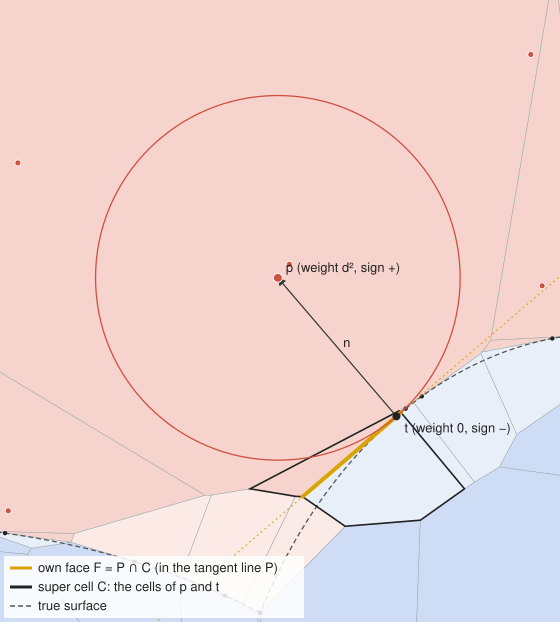
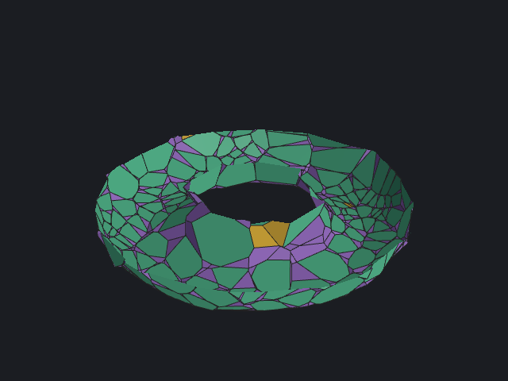
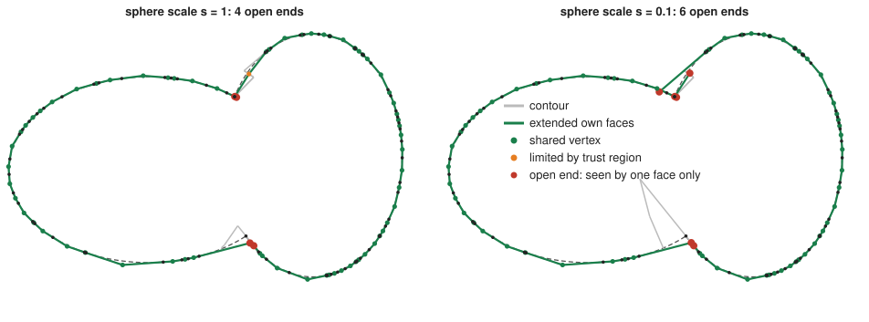
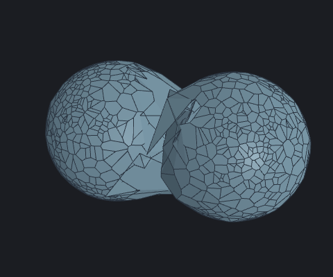

# Recovering a surface from the power contour

This note describes the structure of the power contour of samples plus tangent points, and two ways to turn it into a surface with one face per tangent point: *Contract contour regions* and *Extend own faces*. Code: `recover.js` (`recoverSurface`, `extendOwnFaces`, `qefTruncated`). A third method, *Clip tangent planes*, is described in `ARCHITECTURE.md`.

## Setup

For each sample `p_a` with SDF value `d_a ≠ 0`:

- the **tangent point** `t_a` is its closest surface point, and `n_a = (p_a − t_a) / d_a` is the outward unit normal there (the SDF gradient);
- the **tangent plane** is `P_a = { x : f_a(x) = 0 }` with `f_a(x) = n_a · (x − t_a)`;
- the sample is a site with weight `d_a²` (a sphere of radius `|d_a|` that touches the surface at `t_a`) and sign `sign(d_a)`;
- the tangent point is a site with weight 0 and the opposite sign.

The trusted data are `t_a`, `n_a`, and the sign of `d_a`. The power contour is the set of faces between a `+` cell and a `−` cell. Each site has an *owner*: the sample it comes from.

The figures in 2D are computed with the same constructions in the plane (a 2D power diagram of samples and tangent points on the union of two ellipses, which has two concave creases). In 2D a tangent plane is a line, a face is a segment, and a vertex is where two lines meet. The 3D figures are screenshots of the viewer. To regenerate them: `node figures/make2d.js` and `bash figures/shoot3d.sh`.



*One sample `p` (sphere of radius `d`) and its tangent point `t`. Their two cells together (outlined) are the super cell `C`; the boundary between them is the own face `F`, which lies exactly in the tangent line (dotted). Note that `p` is not inside the outlined cell: neighbors' larger spheres take that space, as is common in power diagrams.*

## Structure

**1. The bisector of a sample and its tangent point is the tangent plane.** With `p = t + d n`:

```
π_p(x) − π_t(x) = |x − p|² − d² − |x − t|² = −2 d · n·(x − t) = −2 d · f(x).
```

This holds for any sphere tangent to `P_a` at `t_a`, whatever its radius. That is what makes the sphere scale below possible.

**2. Super cells and own faces.** The two cells of owner `a` together form a *super cell* `C_a`. Inside `C_a`, the boundary between them is exactly where their powers are equal, which is `P_a`. So the **own face** is

```
F_a = P_a ∩ C_a,
```

a convex polygon lying exactly in the tangent plane. There is exactly one per tangent point, and it contains `t_a`: at `t_a` both sites have power 0, and every other site has positive power (for an exact SDF, `t_a` is outside every other sample's sphere).

**3. Steps.** Every other contour face lies on a wall between two super cells `C_a` and `C_b`. On the wall, `P_a` and `P_b` cut two different lines; the step is the region between them (a double wedge with its apex where the line `P_a ∩ P_b` crosses the wall). Steps exist because neighboring tangent planes do not meet on the wall.


*2D, `s = 1`: the contour (thick) is own faces (gold) joined by steps (red). In 2D, steps on smooth parts are tiny (median length `10⁻⁴` against `0.08` for own faces; inset, ×63); the visible ones are at the concave creases, where the two sides' tangent lines meet inside the shape.*



*3D, torus, 300 samples, `s = 1`, sliced at `z = 0`, colored by face type: own faces (green, each in its tangent plane), steps (purple: sample – other tangent point), and sample – sample faces (gold). In 3D a step is a polygon on a wall between super cells, and steps take a visible share of the contour.*

**4. Own faces never share an edge** (generically). A corner of `F_a` is a power-diagram vertex with four cells, two of which belong to `a`, so it touches at most three owners. An edge of `F_a` has a third cell from another owner, so across it is a step. The exception is a degenerate configuration: on a sphere, by symmetry, `P_a ∩ P_b` lies exactly in the bisector, so there are no steps and the contour already is the tangent-plane polyhedron.

**5. The goal.** Eliminate the steps: extend each own face in its plane until it meets its neighbors' planes. The result has one face per tangent point, edges on the lines `P_a ∩ P_b`, and vertices at the points `P_a ∩ P_b ∩ P_c`. Equivalently, move the walls between super cells so they contain the lines `P_a ∩ P_b`. Then the function `F(x) = f_{a(x)}(x)`, where `a(x)` is the super cell containing `x`, becomes continuous, and its zero set is watertight.

**6. The dual view.** In the regular (weighted Delaunay) triangulation, contour faces are edges between a `+` site and a `−` site. Eliminating the steps means collapsing the edge between each sample and its tangent point. An edge collapse keeps a valid surface only when the link condition holds. Wide steps, which touch several different owners along their length, violate it. They come from large sample spheres, whose cells reach far.

## Sphere scale `s`

Move each sample toward its tangent point and shrink its sphere so it stays tangent there:

```
p_a(s) = t_a + s (p_a − t_a),   weight (s d_a)².
```

By (1), the own face of every tangent point is unchanged for every `s`; only the steps change. The data `t_a`, `n_a`, `sign(d_a)` are untouched. Since `π_{p(s)}(x) − π_t(x) = −2 s d f(x)`, the super cells converge as `s → 0` to the Voronoi cells of the tangent points, each split by its tangent plane. The steps become thin: their height is set by how far neighboring planes miss each other on the Voronoi bisector, about `κh²` for curvature `κ` and spacing `h`.


*Sphere scale in 2D. The own faces (gold) are identical at `s = 1` and `s = 0.1`, as (1) predicts; only the cells and the steps change. At `s = 0.1` the tangent points' cells approach their Voronoi cells. At the lower concave crease the step gets longer, not shorter: it approaches the Voronoi bisector of the two tangent points on either side of the crease, while the true crease is where their tangent lines meet.*

## Approach 1: Contract contour regions (`recoverSurface`)

Each step is given to one of its two owners, so the contour is partitioned into one region per tangent point.

1. Weld the contour's vertices (each cell computes its own copy). Label each own face with its owner. Label each step with whichever of its two owners has the nearer tangent point (measured from the face's centroid).
2. Clean up so each region is one connected piece containing its own face. A stray component goes to its other owner, or else to its most common neighboring region. A region enclosed by a single other region is merged into it.
3. Output vertices: contour vertices where three or more regions meet, placed where those regions' tangent planes meet (see *Vertex placement*).
4. Output faces: each region's boundary loop on the contour, keeping only the output vertices on it. A region whose boundary is not one simple loop, or has fewer than three output vertices, leaves a hole (reported as a non-disc region).

Because the regions tile the contour, neighboring faces share their boundary and vertices by construction, so cracks only appear at non-disc regions. The nearest-tangent-point rule already imposes Voronoi locality on the regions, which is why this method depends little on `s`.


*Contract contour regions in 2D, `s = 0.1`. Left: each contour edge colored by the region (tangent point) it is given to; the long crease steps go to one side. Right: one vertex where each pair of neighboring regions meets, at the intersection of their tangent lines (green), giving a polygon with one edge per tangent point. Every vertex here is the exact intersection, within the trust region; the farthest is 0.022 off the curve.*

## Approach 2: Extend own faces (`extendOwnFaces`)

Steps are not assigned to anyone; each own face is extended from its own boundary.

1. Walk around `F_a`. Each edge borders a step toward one neighbor `b`: the owner of the third cell at that edge.
2. A run of edges facing the same `b` becomes part of the line `P_a ∩ P_b`.
3. A switch from neighbor `b` to neighbor `c` happens at a corner whose four cells are two of `a`'s, one of `b`'s and one of `c`'s. It becomes the vertex `P_a ∩ P_b ∩ P_c`, keyed by the triple `{a, b, c}` and so shared with faces `b` and `c` if they see the same triple.
4. *Flips.* Where four owners meet nearly at one point, the faces can disagree about which diagonal is an edge, so a triple is seen by fewer than its three faces. Incomplete triples linked by sharing two owners are merged into one vertex where all of their planes meet, if they involve at most four owners ("Merge flipped junctions"). Other disagreements leave cracks.

This is the most literal form of "one face per tangent point, eliminate the rest", but because each face decides its neighbors alone, it leaves more cracks than the partition. It depends strongly on `s`: large spheres make wide steps, whose far ends are seen differently by different faces.



*Extend own faces in 2D, at `s = 1` and `s = 0.1`. Each own face is extended along its tangent line to the vertex it shares with the neighbor named by the third cell at its end. On smooth parts every end is matched and the result equals the contraction's (max error 0.022 in both). At the creases, tangent points crowd together and the steps between two faces pass through cells of a third owner, so face `a` names `b` while `b` names `c`. The ends then do not match, leaving cracks (red): 4 open ends at `s = 1`, 6 at `s = 0.1`. In 2D the steps on smooth parts are already tiny at `s = 1` (see above), so `s` matters little here; the strong dependence on `s` reported below is a 3D effect, where steps are wide polygons. The contraction has no cracks, because its regions tile the contour.*

## Vertex placement (`qefTruncated`)

A vertex shared by regions or faces `a, b, c, …` minimizes `Σ (n_k·x − n_k·t_k)²`. With exact tangent data there is no noise, so the minimizer is the exact intersection of the planes when they are independent. Writing `A = Σ n nᵀ` with eigenvalues `λ` and eigenvectors `u`, and `m` for the vertex's contour position, the solution is `m` plus one correction along each `u` (these corrections are orthogonal). Two rules decide which corrections to keep:

- **Dependent planes** (`tau`, "Dependent planes, log₁₀"). Eigenvalues below `tau · λ_max` are dropped: there is no unique intersection in that direction (coplanar faces of the box: `A` has rank 1). This is only for exact degeneracies; `tau = 10⁻¹²` is numerical precision.
- **Trust region** (`trust`, "Trust radius × spacing", default 2). A tangent plane is a first-order model of the surface, accurate only within about one sample spacing of its tangent point. So the vertex may move at most `ρ = trust × (distance from m to the farthest of its tangent points)`. Corrections are added from the best-determined direction (largest `λ`) down, keeping as many as stay within `ρ`: the exact intersection of the planes if it is near; otherwise the nearest point on the line where the two best-determined planes meet; otherwise a point on their average plane; otherwise `m`.

### Why the torus vertices flew off

With exact intersections and no trust region, vertices on the torus land up to 615 units away. This is not a numerical error. Solving the worst vertices independently with Cramer's rule:

| distance off the surface | `det(n₁,n₂,n₃)` | residual on the three planes | moves under `10⁻⁹` normal noise | tangent points span | max normal angle |
|---|---|---|---|---|---|
| 615 | 5.6e-7 | 1.9e-12 | 0.42 | 0.098 | 12° |
| 61 | 3.1e-5 | 9.4e-14 | 1.3e-3 | 0.174 | 23° |
| 19.5 | 8.8e-6 | 4.3e-14 | 5.0e-4 | 0.083 | 10° |
| 6.7 | 1.5e-4 | 7.4e-16 | 2.7e-5 | 0.145 | 19° |

The vertices lie on their three planes to `10⁻¹²` or better. The problem is ill-conditioned (a gain of about `10⁸` from normals to position), but the tangent data is exact to about `10⁻¹⁶`, so the numerical error is at most about `10⁻⁸`. These are the true intersection points. Three tangent planes from points only 0.1 apart, with normals within 12°, can meet 600 units away when their normals are nearly coplanar: the planes then share an almost common line, and their single common point is far along it.

The missing piece of the theory: that three faces adjacent on the contour have tangent planes meeting near the surface. That holds where neighboring normals spread in two directions. It fails along curves where they vary in only one direction (the torus's top and bottom circles, where one principal curvature is zero) and on cylinder-like regions in general. There the arrangement of the planes has long faces along the flat direction, its adjacency is anisotropic, and the contour's isotropic (Voronoi-like) adjacency can name a triple whose planes do not meet nearby. The trust region encodes the missing condition directly: an intersection is only used where the planes are valid.


*The 2D analog. Near an inflection (zero curvature) the tangent lines of two neighbors are nearly parallel and offset, so their exact intersection is far (here 2.7 from the contour vertex, about six times its distance to the farther tangent point). It is the correct intersection of the two lines; the lines are just not valid that far out. The trust region (2 × the distance to the farther tangent point) rejects it, and the vertex moves only along the best-determined direction, onto the average line.*

| exact intersections, no trust region | `tau = 10⁻²`, no trust region | exact + trust 2 (default) |
|---|---|---|
|  |  |  |

*Torus, 1500 uniform samples, `s = 0.1`, Contract contour regions. Left: exact intersections fly up to 615 units away. Middle: dropping small eigenvalues removes them, but it also drops exact intersections at sharp features (the box then has 16 vertices off). Right: the trust region removes them and keeps exact intersections where they are near.*

### Results of the fix

Contract contour regions, `s = 0.1`; "off" counts vertices with `|sdf| > 0.02`:

| | `tau = 10⁻²` (previous default) | exact (`tau = 10⁻¹²`), no trust region | exact + trust 2 (default) |
|---|---|---|---|
| torus, 1500 uniform | 26 off, max 0.080, area 9.03 | 277 off, max 615, area 41.9 | 64 off, max 0.076, area 9.11 |
| torus, 300 uniform | 138 off, max 0.23, area 9.84 | 236 off, max 65, area 27.9 | 173 off, max 0.24, area 9.66 |
| two spheres, 1500 uniform | 22 off, max 0.032, area 6.95 | 37 off, max 1.24, area 8.83 | 27 off, max 0.067, area 7.06 |
| box, 1500 uniform | 16 off, max 0.046, area 6.68 | 0 off, area 6.64 (exact) | 0 off, area 6.64 (exact) |
| box, 300 uniform | 28 off, max 0.13, area 6.79 | 0 off, area 6.64 | 0 off, area 6.64 |
| torus, 1500 near surface | 0 off, max 0.017 | 198 off, max 50 | 24 off, max 0.033 |
| two spheres, 1500 near surface | 3 off, max 0.039, crease 0.007 | 25 off, max 9.9 | 8 off, max 0.056, crease 0.009 |

True areas: torus 8.88, two spheres 6.91, box 6.64. "Crease" is the median distance from crease vertices to the true crease circle.

The trust region removes every far vertex while keeping exact intersections where they are valid, so the box comes out exact. On smooth parts it keeps more intersections than `tau = 10⁻²` did, and an intersection two spacings out carries about `κr²/2` of extrapolation error, so a few more vertices are off by more than 0.02 there; the worst errors are about the same. With `trust = 1` smooth parts are tighter but some box corners are cut short (59 off at 1500 samples).

| box | two spheres |
|---|---|
|  |  |

*Default settings, 1500 uniform samples, `s = 0.1`. The box is exact: every vertex is an exact intersection of its planes. The two spheres are smooth, but the concave crease still has fins: faces whose vertices are each near the surface (max 0.067 off) but which reach across the crease.*

## Is there an ideal `s` and `tau`?

Both theory and experiments. Experiments: 1500 uniform random samples, seed 1; "see-through" counts rays from outside to an interior point that cross no face (out of 400); true areas are torus 8.88, two spheres 6.91, box 6.64.

### Sphere scale: it depends on the method

**Theory.** By (1), `s` changes only the steps, and `s → 0` gives the Voronoi cells of the tangent points: the restricted-Delaunay neighborhood that surface reconstruction theory works with. Larger `s` lets far samples' big spheres make wide steps. Two things limit how far toward 0 to go:

- *Numerical precision.* `powerdiagram.js` decides inside/outside with an absolute tolerance of `1e-10` on `2(p_j − p_i)·x − c`, and for a sample and its own tangent point `|p_j − p_i| = s|d|`. So the tangent plane is resolved only to about `1e-10 / (2 s |d|)`, which grows as `1/s`. A tolerance relative to `|p_j − p_i|` would push this floor lower.
- *Ties in the partition.* As `s → 0`, each step lies on the Voronoi bisector of its two owners, so the partition's rule (give the step to the owner with the nearer tangent point) becomes a tie, decided by rounding. Extend own faces has no such rule.

**Experiments.** Contract contour regions, `tau = 10⁻²`:

| `s` | 1 | 0.1 | 0.01 | 10⁻³ | 10⁻⁴ | 10⁻⁵ | 10⁻⁶ |
|---|---|---|---|---|---|---|---|
| torus: open edges | 0 | 8 | 13 | 20 | 100 | 670 | 2066 |
| torus: see-through | 0 | 0 | 1 | 1 | 2 | 27 | 113 |
| two spheres: open edges | 0 | 0 | 0 | 51 | 299 | 1288 | 1319 |
| two spheres: see-through | 0 | 0 | 0 | 3 | 22 | 162 | 329 |

With 300 samples the partition prefers smaller `s`: hole edges at `s = 1` vs `0.1` are 14 vs 0 on the two spheres and 18 vs 0 on the box.

Extend own faces depends on `s` much more strongly. On the torus it has 50 see-through rays and 1328 open edges at `s = 1`, against 2 and 84 at `s = 0.1`, and 0 and 15 at `s = 0.01`. Collapsing each owner's two sites into one is valid where every owner pair ends up at exactly two vertices; on the torus, the number of pairs that do not drops from 3483 at `s = 1` to 203 at `s = 0.01`.

So the ideal is the limit `s → 0` for Extend own faces, as far as the arithmetic allows (about `0.01` with the current tolerance). Contract contour regions is less sensitive and does best around `s = 0.1–1`, degrading slowly below that because of the ties. `s = 0.1` is a good setting for both.

### Dependent planes: not a precision parameter on its own

**Theory.** An exact intersection of three exact tangent planes is the right vertex only if those three faces really are adjacent in the arrangement of the planes. The contour's adjacency is isotropic (Voronoi-like). The plane arrangement's is not: on saddles, and near curves of zero Gaussian curvature such as the torus's top and bottom circles, neighboring normals lie nearly on one great circle, and the true intersection of three neighboring planes can be far away. Where the two disagree, the exact intersection is a spike. On smooth parts, three neighboring normals differ by about `κh`, so the eigenvalue ratio of `Σ n nᵀ` is of order `(κh)²` times a small shape factor. At real features (box edges and corners, the two-sphere crease at 110°) it is of order 1. So `tau` is a threshold between curvature-scale and feature-scale normal changes: it should satisfy roughly `(κh)² ≪ tau ≪ tan²(θ_feature / 2)`. That window widens as sampling gets denser, but at a fixed density there is no setting that is right "up to numerical precision".

**Experiments.** Contract contour regions, `s = 0.1`:

| | `tau = 10⁻¹²` (exact) | `tau = 10⁻²` |
|---|---|---|
| torus: vertices off by > 0.02 | 277, max 615 | 26, max 0.08 |
| torus: area | 41.9 | 9.03 |
| two spheres: max error, area | 1.24, 8.83 | 0.032, 6.95 |
| box: vertices off by > 0.02, area | 0, 6.64 (exact) | 16, 6.68 |

The box wants exact intersections (its planes are exactly coplanar or exactly orthogonal), the curved shapes do not.

The eigenvalue ratios confirm that there is no clean threshold on smooth parts. With exact intersections, the torus vertices that fly off have ratios with median `6·10⁻⁶` but up to `4·10⁻²`, while the good ones have median `1.6·10⁻⁴`. On the two spheres, the bad ones (median `5·10⁻³`) are better conditioned than the good ones (`6.6·10⁻⁴`). So the remaining outliers are combinatorial, not numerical, and `tau = 10⁻²` works by switching plane intersection off on nearly all smooth parts (where the contour vertex is as accurate, both errors being `O(κh²)`) and keeping it at features.

With the trust region (see *Vertex placement*), `tau` no longer has to do this job and can be set to numerical precision. A fuller fix would also take the combinatorics from the plane arrangement near such vertices (which faces the local envelope of the planes makes adjacent) instead of only limiting how far the vertex moves.

## Results

Before the trust region: 1500 samples, `s = 0.1`, `tau = 10⁻²` (see *Results of the fix* for the current default):

| | torus, uniform | two spheres, uniform | torus, near surface |
|---|---|---|---|
| Contract contour regions | see-through 0, area 9.03, 26 vertices off > 0.02 | see-through 0 (and 0 of 600 through the crease band), area 6.95, max error 0.032 | see-through 0, 0 open edges, 0 off, area 8.96 |
| Extend own faces | see-through 2, area 8.99, 22 off | see-through 0 (0 of 600 through the crease), area 6.99 | see-through 0, area 8.96 |

## Open problems

- Non-disc regions (partition) and cracks (extension) at sparse sampling.
- Where the contour's adjacency does not match the plane arrangement, the trust region keeps vertices near the surface, but their faces are then no longer exactly planar.
- The absolute tolerance in `powerdiagram.js` limits how small `s` can be.
