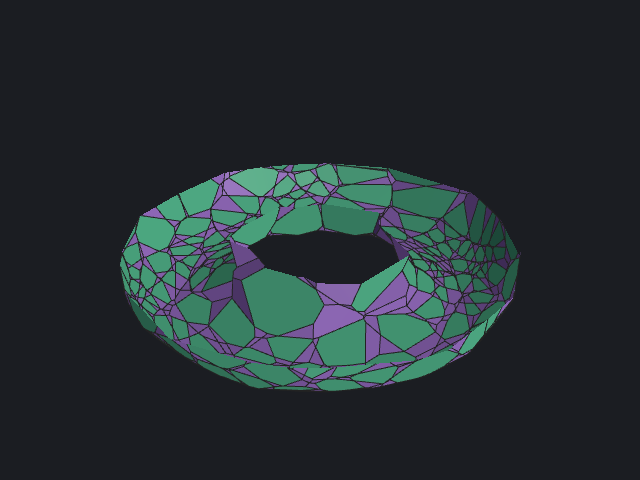
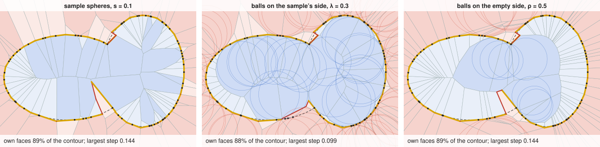
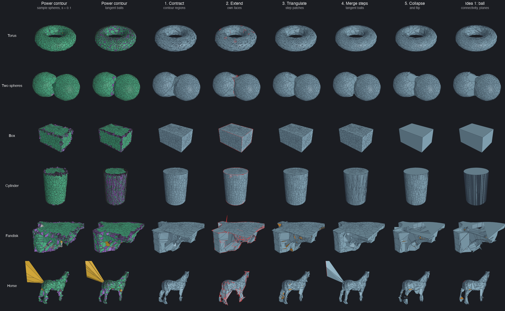

# Recovering a surface from the power contour

**Goal.** From SDF samples we know, for each sample `p_a`, its tangent point `t_a` (the closest surface point) and the normal `n_a` there. The power contour of the samples and their tangent points is a closed surface, but it is lumpy and far more complex than the data warrants. Among its faces, the ones that contain a tangent point carry trustworthy information: a point and its tangent plane. We want a surface made *only* of such facets: one planar polygon per tangent plane, containing its tangent point, with neighboring polygons sharing edges. This note explains the structure of the contour that makes this possible, five ways we tried to get there, how their outputs compare, experiments with four new ideas (§5), and which ideas are worth keeping.

| | method | one-line idea | code |
|---|---|---|---|
| 0 | the power contour | the baseline: faces between `+` and `−` cells | `powerdiagram.js` |
| 1 | Contract contour regions | give every other face to a tangent point; intersect planes where regions meet | `recoverSurface` |
| 2 | Extend own faces | grow each tangent-plane face until it meets its neighbors' planes | `extendOwnFaces` |
| 3 | Triangulate step patches | remove each patch of non-tangent faces by triangulating the loop of faces around it, using the planes to choose | `triangulatePatches` |
| 4 | Tangent balls + Merge steps into faces | change the generators so the other faces almost lie in the planes, then merge them in | `tangentBallSites`, `mergeSteps` |
| 5 | Collapse and flip | repair Approach 3's connectivity with plane-only tests | `triangulatePatches` (option `rank`) |
| — | Clip tangent planes | clip each plane by its neighbors' planes (an earlier method; see `ARCHITECTURE.md`) | `clipTangentPlanes` |
| Idea 1 | Ball connectivity, plane vertices | Approach 4's regions as connectivity, Approach 5's plane vertices (§5) | `triangulatePatches` (options `partition`, `patchDP`) |

Reproducing: the numbers come from `node figures/compare.js [n] [random|band]` and `node figures/experiments.js`, the 2D figures from `node figures/make2d.js`, the 3D figures from `bash figures/shoot3d.sh` (headless Chrome; the fandisk needs `../../code-release/examples/fandisk.obj` and the horse gpytoolbox's `horse.obj`, see the scripts). The earlier, piecemeal version of this note, with every experiment log, is `RECOVERY.md` at commit `a9b3cf2`.

## 1. Background

### 1.1 The data and the sites

For each sample `p_a` with SDF value `d_a ≠ 0`:

- the tangent point `t_a` is its closest surface point, and `n_a = (p_a − t_a) / d_a` is the outward unit normal there;
- the tangent plane is `P_a = { x : f_a(x) = 0 }`, with `f_a(x) = n_a · (x − t_a)`;
- the sample is a site with weight `d_a²` (a sphere of radius `|d_a|` touching the surface at `t_a`) and sign `sign(d_a)`;
- the tangent point is a site with weight 0 and the opposite sign.

The trusted data are `t_a`, `n_a` and the sign. Both sites of a sample have that sample as their *owner*.

### 1.2 The power contour (the baseline)

The power contour is the set of faces between a `+` cell and a `−` cell. It is closed and watertight by construction. Its faces are of two kinds.

**Own faces lie exactly in the tangent planes.** For `p = t + d n`, the power difference of a sample and its tangent point is

```
π_p(x) − π_t(x) = |x − p|² − d² − |x − t|² = −2 d · f(x),
```

so their bisector is the tangent plane. This holds for every sphere tangent to `P_a` at `t_a`, whatever its radius or side. The two cells of owner `a` form a *super cell* `C_a`, and the face between them, the **own face** `F_a = P_a ∩ C_a`, is a convex polygon in the tangent plane that contains `t_a`. There is exactly one per tangent point. These are the "good" facets.

**Steps are everything else.** Every other contour face lies on a wall between two super cells, between the lines where `P_a` and `P_b` cross that wall. A step exists because neighboring tangent planes do not meet on the wall. Generically **own faces never share an edge**: an edge of `F_a` has a third cell from another owner, so a step lies across it. (The sphere is the exception: by symmetry the planes meet exactly on the bisectors.)


*2D: one sample `p` (circle of radius `d`) and its tangent point `t`. Their two cells together (outlined) are the super cell; the boundary between them, the own face, lies in the tangent line.*


*2D: own faces (gold) joined by steps (red). In 2D the steps on smooth parts are tiny (inset, ×63); the visible ones are at concave creases.*


*3D, torus, 300 samples, sliced: own faces (green) and steps (purple, gold). In 3D steps take a visible share of the contour.*

The contour is the "lumpy surface": it has up to 6 times as many faces as there are tangent points (torus 8964 for 1500), and on shapes with flat or developable parts its steps reach far out (the spikes in the first column of the comparison in §3). On the box with 1500 near-surface samples its vertices are up to 1.0 off the surface and its area is 9.75 against 6.64.

### 1.3 The target, and its dual

Eliminate the steps: extend each own face in its plane until it meets its neighbors' planes. The result has one face per tangent point, edges on the lines `P_a ∩ P_b`, and vertices at the points `P_a ∩ P_b ∩ P_c`.

It is easiest to think about in the **dual**: one dual vertex per facet (per tangent point), one dual edge per pair of adjacent facets, one dual triangle per output vertex. A choice of *connectivity* is a triangulation of the tangent points; given it, the *geometry* is determined: every vertex is the intersection of its three planes. All five methods are different ways to choose this triangulation (explicitly or implicitly) and to cope with triangles whose three planes do not meet nearby.

In the power diagram's own dual (the weighted Delaunay triangulation), eliminating steps means collapsing the edge between each sample and its tangent point. Edge collapses keep a manifold only under the link condition, which wide steps violate; this is why simply "collapsing" is not enough.

### 1.4 Sphere scale `s`

Move each sample toward its tangent point and shrink its sphere so it stays tangent: `p_a(s) = t_a + s (p_a − t_a)`, weight `(s d_a)²`. By §1.2 the own faces do not change; only the steps do. As `s → 0` the super cells become the Voronoi cells of the tangent points, each split by its plane, and steps thin to about `κh²` (curvature × spacing²). `s = 0.1` is the default for Approaches 1–3 and 5. Very small `s` runs into the absolute tolerance `1e-10` of `powerdiagram.js` (the plane is resolved only to about `1e-10 / (2 s |d|)`).


*Sphere scale in 2D: identical own faces at `s = 1` and `s = 0.1`; only the cells and steps change.*

### 1.5 Placing a vertex: far intersections and the trust region

Approaches 1, 2, 3 and 5 place each vertex where its faces' planes meet (`qefTruncated`: least squares on `Σ (n_k · x − n_k · t_k)²` about the contour vertex). With exact data, three independent planes meet at one exact point. The trouble is that this point can be very far away: three tangent planes 0.1 apart, with normals within 12° of each other but nearly coplanar, meet 600 units away. This is not round-off (the points satisfy their planes to `10⁻¹²`); the planes are simply not valid that far out. It happens where neighboring normals vary in one direction only: cylinders, cones, the torus's top and bottom circles (`K = 0`).

The underlying cause is combinatorial: the contour's adjacency is isotropic (Voronoi-like), while the arrangement of the planes is anisotropic there (long faces along the flat direction). The contour names a triple of faces that are not neighbors in the planes' arrangement.

Two guards exist:

- **Dependent planes `tau`**: drop directions whose eigenvalue in `Σ n nᵀ` is below `tau × λ_max`. `10⁻¹²` (default) only removes exact degeneracies, such as coplanar box faces. `10⁻²` would remove the far points, but also the exact corners of the box.
- **Trust radius**: a vertex may move at most `trust × (distance to the farthest of its tangent points)` from its contour position (default `trust = 2`). Within it, the exact intersection is used; beyond it, the nearest point on the line of the two best-determined planes, or on their average plane.


| exact intersections, no trust region | `tau = 10⁻²` | exact + trust 2 (default) |
|---|---|---|
|  |  |  |

*Torus, 1500 uniform samples, Contract contour regions. Left: vertices fly up to 615 units away (area 41.9 against 8.88). Middle and right: the far points are gone; only the trust region also keeps the box exact.*

A useful fact for choosing triangles: on a surface locally `z = ½ xᵀQx`, three tangent planes meet above the `Q`-circumcenter of their tangent points, at height error `−½ R_Q²`, and `det(n_a, n_b, n_c) = 2K · area`. So the best triangulation on a convex or concave patch is the Delaunay triangulation in the metric `Q`, and near `K = 0` every triangle is ill-conditioned, whatever the triangulation.

## 2. The methods

### Approach 1: Contract contour regions (`recoverSurface`)

**Idea.** Paint the contour: every own face gets its owner's color, and every step gets the color of whichever of its two owners has the nearer tangent point. Each color is then one region per tangent point, and the regions tile the contour. Shrink each region to a polygon whose corners are where three or more regions meet, placed where those regions' planes meet.

**Details.** After welding, a cleanup makes each region one connected piece containing its own face (stray components go to their other owner or their most common neighbor; enclosed regions merge). Regions that are not discs still become faces: split regions give one face per piece, pinched regions a weakly simple polygon, regions with own faces inside an annulus a face with a hole, and pieces with fewer than three junctions collapse to an edge. So no region is dropped and the result is closed by construction.

The nearest-tangent-point rule makes the regions the restricted Voronoi cells of the tangent points, and their junctions the restricted Delaunay triangles: the connectivity is *isotropic*. That is the natural tie-break on flat parts and robust everywhere, but wrong where the planes' arrangement is anisotropic.


*2D: each contour edge colored by its region (left); one vertex where neighboring regions meet, at the intersection of their tangent lines (right).*

### Approach 2: Extend own faces (`extendOwnFaces`)

**Idea.** The most literal version of the goal: leave steps unassigned, and let each own face grow in its plane. Walk around `F_a`; each edge faces a step toward some neighbor `b` (the owner of the third cell there), and a run of edges toward `b` becomes part of the line `P_a ∩ P_b`. Where the neighbor changes from `b` to `c`, place the vertex `P_a ∩ P_b ∩ P_c`, keyed by the triple `{a, b, c}` so that faces `b` and `c` find it too. Where four owners meet nearly at one point and faces disagree about the diagonal, incomplete triples sharing two owners are merged ("Merge flipped junctions").

**What it teaches.** Each face reads its neighbors locally, so the neighbor relation is not symmetric: `a` names `b` while `b` names `c`, and the unmatched ends are cracks. In 2D, reading neighbors from the contour's connectivity instead ("join consecutive own faces along the contour", the chain rule) is crack-free. In 3D the chain rule needs a decision about which own faces become adjacent across a patch of steps, which is what Approaches 1 and 3 supply. Connectivity must be decided once, on a shared structure, not per face.


### Approach 3: Triangulate step patches (`triangulatePatches`)

**Idea.** Keep every own face exactly. Because own faces often touch at corners, the steps form many small connected *step patches*, each surrounded by a loop of own faces `a_1 … a_k`. Removing a patch means making some of those faces adjacent: that is a triangulation of the `k`-gon of faces, `k − 2` triangles, each a vertex `P_a ∩ P_b ∩ P_c`. Choose the triangulation from the **planes**, not from distances between tangent points.

**The planes' criterion.** Whether a loop edge is convex or concave is read from the data alone: `f_a(t_b) + f_b(t_a) < 0` is convex (each tangent point below the other's plane), `> 0` concave. Where all edges are convex, the surface is locally the boundary of the intersection of half-spaces `f ≤ 0` (an envelope); all concave, of their union. An envelope of planes is itself a power diagram (Aurenhammer), so the right triangulation is a regular triangulation of the planes: on a quadric, the Delaunay triangulation in the metric `Q`. On saddles, where convex and concave edges alternate, the surface is a lattice (max–min) polyhedron of its planes (Ovchinnikov): grouping faces by convex runs gives one reading, by concave runs the other, and for `k = 4` the two readings are exactly the two diagonals, the same ambiguity as the marching-cubes saddle (resolved here by comparing the two readings' costs, plus a rule preferring the coarser grouping).

**Algorithm.** (1) Start from Approach 1's painted contour. (2) Each single-loop patch with up to 24 faces is triangulated by the `O(k³)` minimum-cost polygon triangulation dynamic program (Klincsek), the cost of a triangle being how far its vertex violates the reading. (3) Patches with two loops are stitched (Fuchs, Kedem and Uselton). (4) Larger patches keep Approach 1's partition, flipped toward the envelope where convex or concave; on a flat side of the box every plane is the same, and the Delaunay tie-break of the partition is the right answer. (5) A vertex beyond the trust radius becomes a small *chamfer* (one point on each line `P_a ∩ P_b`, plus an extra face), so that every tangent-plane face stays exactly planar. (6) Faces are the duals: the cycle of triangles around each own face.

**Limits.** Near `K = 0` (torus top circle, cylinders) the triangles still name non-neighbors in the planes' arrangement, and chamfers (310 on the uniform torus, 553 on the near-surface fandisk) only hide them.

### Approach 4: Tangent balls and Merge steps into faces (`tangentBallSites`, `mergeSteps`)

**Idea.** Instead of removing steps afterwards, change the generators so that steps nearly vanish, then keep the diagram's own vertices: no plane is ever intersected, so no vertex can fly off.

**Any tangent ball keeps the own face.** Replace sample `a`'s sphere by a ball of radius `λ` tangent to `P_a` at `t_a` on either side. By §1.2 the own face is unchanged. A step between `a`'s ball and `b`'s tangent cell then lies at height

```
f_a(x) = (|x − t_a|² − |x − t_b|²) / (2λ_a)
```

above `P_a`: steps flatten onto the planes like `1/λ`. But a ball may not contain another tangent point (it would steal that point's cell), so `λ_a` is bounded by the largest empty ball tangent at `t_a` on that side, a discrete medial ball computed from the tangent points alone (cf. the power crust's poles). Put each ball on the side with the larger empty ball, radius `min(cap, ρ r_a)` (`ρ = 0.5`, cap 100). On convex, concave, flat and developable parts the balls are huge and the steps nearly vanish; on saddles both empty balls are `≤ 1/κ` and steps stay `O(κh²)`.

**No generator gets the planes exactly.** On `L = P_a ∩ P_b`, any site tangent at `t_a` has power `|x − t_a|²` (plus a constant), so the wall between `a` and `b` meets `L` at a single point, whatever radii, sides or weights are chosen. Exact containment would require moving the tangent sites within their planes ("virtual tangent points"), which is overdetermined two to one. Some post-processing is always needed.

**Merging.** Give each step to the owner whose plane it is nearer, clean up as in Approach 1, and output each region's boundary with *all* its vertices at their contour positions. Watertight and with no far vertices, but faces are planar only up to the merged step heights, and there are 2–6 times as many vertices. Options: *Snap* (pull vertices toward their planes) or *gap faces* (exactly planar faces, plus faces filling the gaps).

**Anisotropy for free.** On a cylinder, the faces become strips along the rulings, the envelope's structure, which no other method builds. The strips are ragged and end after a few spacings because each is assembled from steps of different heights.



*Torus, 300 samples, tangent balls: on the outer (convex) half the steps lie almost in the planes of the own faces next to them; on the inner (saddle) half they are visible.*



### Approach 5: Collapse and flip (`triangulatePatches`, option `rank`)

**Idea.** Keep Approach 3's dual triangulation but repair it with tests that use only the planes, before placing any vertex.

1. **Collapse** dual edges whose two planes coincide (normals and offsets equal to `10⁻⁷`), when the link condition holds. A facet may then own several tangent points: the box's flat sides become a few faces. Its trust radius uses the nearest of them.
2. **Envelope flips without triple points.** Write planes as `h_a = (n_a, −n_a · t_a)`. Then `f_d(x_abc) = D4(a,b,c,d) / D3(a,b,c)`, with `D4 = det[h_a; h_b; h_c; h_d]` and `D3 = det[n_a; n_b; n_c]`. In an all-convex or all-concave quad, edge `ac` is on the envelope iff `κ σ D4(a,b,c,d) ≥ 0` (`κ = ∓1` for convex/concave, `σ` the orientation of the Gauss image). This is an in-sphere test in plane coordinates: it needs no triple point and holds when `x_abc` is at infinity. Four strip planes of a cylinder have `D4 = 0`, a tie.
3. **Mixed-quad flips.** In quads with both edge types, flip when it lowers a cost of *far vertices* (beyond the trust radius) and *inverted edges*: each dual edge `p–q` puts its two vertices on the line `P_p ∩ P_q`, and walking around face `p` the edge must run along `±(n_p × n_q)` according to its type; a negative signed length is a fold. In an all-convex quad this inversion test is the envelope test, so this generalizes it to mixed edges. Each flip lowers the total cost, so it terminates.

**Limits.** On a cylinder every quad of four strips is a tie, so local flips grow strips only one or two rows from the caps; a ladder of strips would need a direct construction. Naive alternatives failed: flipping to maximize `|det|` gives planes that meet, but as non-neighbors (cylinder: 0.012 → 0.251), and applying the far-plus-inversion cost to tie quads destroys the cylinder.

### Clip tangent planes (`clipTangentPlanes`)

An earlier method that uses only `t`, `n` and signs: neighbors come from a diagram of mirrored pairs `t ± δn`, and each tangent plane is clipped by its neighbors' half-spaces (unions across concave creases). Every face is exactly planar and contains its tangent point, but faces share no vertices: the result is a polygon soup, with gaps, overlaps and, on the fandisk, large spurious faces. It shows the opposite trade-off from Approach 4: perfect facets, no shared edges.

## 3. Comparison

All runs: seed 1, `s = 0.1`, exact `tau`, trust 2; Approach 4 uses tangent balls (`ρ = 0.5`, cap 100), the others sample spheres. **Uniform** samples fill the domain `[−1.5, 1.5]³` and are the main test: most samples are far from the surface, so their spheres are large and the steps wide. **Near-surface** samples (`|d| < 0.1`) are an easier case, reported second. The horse (gpytoolbox's test mesh) is thin, so with 1500 uniform samples it is under-resolved: every method's area is 5.0–5.7 against the true 4.27.

### 3.1 Visual



*1500 uniform samples. Columns 1–2: the raw contour, green own faces and purple steps. Columns 3–7: the five methods; column 8: Idea 1 (§5), tangent-ball connectivity with plane vertices. Red edges are hole edges, orange faces chamfers. The individual shots are `figures/cmp-<shape>-<method>.png`.*

What to look for:

- **The raw contour** with sample spheres has spikes wherever steps reach far. With tangent balls it is already close to the surface on the box and cylinder; on the horse a large ball makes faces reach the domain's edge.
- **Contract** and **Triangulate** look alike: isotropic, Voronoi-like faces everywhere, including on the flat box sides and the cylinder.
- **Extend** shows its red cracks along the box and cylinder edges and around the fandisk.
- **Merge** is the only one of the five with long strips on the cylinder side; its faces, although many, are not quite planar, and it fails on the horse.
- **Collapse and flip** has the fewest faces: the box and the fandisk's flat top are a few large faces. Its cylinder side remains isotropic.
- **Idea 1** combines the two: strips on the cylinder side and large flat faces, with vertices where the planes meet.

### 3.2 Numerical

**Accuracy**: largest distance of a vertex from the true surface / number of vertices farther than 0.02. 1500 uniform samples:

| | torus | two spheres | box | cylinder | fandisk | horse |
|---|---|---|---|---|---|---|
| power contour, `s = 0.1` | 0.083 | 0.379 | 0.106 | 0.101 | 0.251 | 1.411 |
| power contour, tangent balls | 0.041 | 0.039 | `3·10⁻⁴` | 0.002 | 0.178 | 1.407 |
| 1. Contract contour regions | 0.076 / 64 | 0.067 / **27** | **exact / 0** | 0.022 / 2 | 0.299 / 131 | 0.180 / 207 |
| 2. Extend own faces | 0.076 / 51 | 0.179 / 30 | `3·10⁻⁵` / 0 | 0.023 / 1 | 0.326 / 118 | 0.196 / 176 |
| 3. Triangulate step patches | 0.055 / 14 | 0.163 / 37 | exact / 0 | 0.012 / 0 | 0.307 / 214 | 0.215 / 350 |
| 4. Merge steps (tangent balls) | 0.041 / 33 | **0.039** / 50 | `3·10⁻⁴` / 0 | 0.002 / 0 | **0.135** / 344 | 1.406 / 563 |
| 5. Collapse and flip | **0.025 / 5** | 0.116 / 38 | exact / 0 | 0.012 / 0 | 0.307 / 101 | 0.276 / 280 |
| Clip tangent planes | 0.273 / 276 | 0.370 / 135 | 0.190 / 57 | 0.374 / 235 | 1.182 / 2191 | 0.740 / 1548 |
| Idea 1 (§5) | 0.043 / 6 | 0.116 / 31 | exact / 0 | **`4·10⁻⁴` / 0** | 0.184 / **76** | **0.175 / 192** |

Same, 1500 near-surface samples:

| | torus | two spheres | box | cylinder | fandisk | horse |
|---|---|---|---|---|---|---|
| power contour, `s = 0.1` | 0.023 | 0.448 | 1.000 | 1.053 | 0.675 | 0.878 |
| power contour, tangent balls | 0.016 | 0.013 | `2·10⁻⁴` | 0.001 | 0.103 | 0.079 |
| 1. Contract contour regions | 0.033 / 24 | 0.056 / 8 | 0.042 / 3 | 0.066 / 7 | 0.101 / 48 | 0.084 / 126 |
| 2. Extend own faces | 0.033 / 24 | 0.067 / 6 | 0.042 / 3 | 0.065 / 7 | 0.579 / 80 | 0.836 / 89 |
| 3. Triangulate step patches | 0.035 / 2 | 0.127 / 18 | 0.198 / 11 | 0.030 / 2 | 0.154 / 82 | 0.100 / 229 |
| 4. Merge steps (tangent balls) | **0.016 / 0** | **0.013 / 0** | `2·10⁻⁴` / 0 | 0.001 / 0 | **0.096** / 210 | **0.056** / 142 |
| 5. Collapse and flip | 0.028 / 1 | 0.061 / 8 | **exact / 0** | 0.006 / 0 | 0.173 / **40** | 0.094 / 142 |
| Clip tangent planes | 0.190 / 206 | 0.405 / 139 | 0.156 / 15 | 0.099 / 41 | 1.392 / 1731 | 1.387 / 1721 |
| Idea 1 (§5) | 0.061 / 1 | 0.088 / 6 | exact / 0 | **`4·10⁻⁴` / 0** | 0.502 / 41 | 0.067 / **105** |

**Sparse samples** (300 uniform), largest error:

| | torus | two spheres | box | cylinder | fandisk | horse |
|---|---|---|---|---|---|---|
| 1. Contract | 0.240 | **0.084** | exact | 0.068 | 0.688 | **0.230** |
| 2. Extend | 0.182 | 0.167 | 0.009 | 0.068 | 0.366 | 0.323 |
| 3. Triangulate | 0.288 | 0.093 | exact | 0.739 | 0.738 | 0.342 |
| 4. Merge | **0.091** | 0.094 | 0.002 | 0.009 | **0.202** | 1.323 |
| 5. Collapse and flip | 0.173 | 0.093 | exact | 0.261 | 0.443 | 0.351 |
| Idea 1 (§5) | 0.120 | 0.093 | exact | **0.003** | 0.278 | 0.338 |

**Structure**, 1500 uniform samples: vertices; hole edges (directed edges with no reversed twin); off-plane (largest distance of a facet's vertex from its own tangent plane); area (true: torus 8.88, two spheres 6.91, box 6.64, cylinder 5.97, fandisk 8.82, horse 4.27). The contour rows give the face count, the share of the area in own faces, and the area.

| | torus | two spheres | box | cylinder | fandisk | horse |
|---|---|---|---|---|---|---|
| contour, `s = 0.1` | 8864, 93%, 9.39 | 1606, 92%, 7.60 | 5221, 77%, 7.27 | 9418, 85%, 6.33 | 5857, 65%, 12.10 | 6444, 55%, 7.81 |
| contour, tangent balls | 8627, 67%, 9.01 | 1605, 96%, 7.01 | 5854, 77%, 6.64 | 10105, 40%, 5.97 | 6024, 61%, 9.78 | 6366, 45%, 6.63 |
| 1. Contract | 3000, 0, 0.020, 9.11 | 2996, 0, 0.051, 7.06 | 2310, 0, 0, 6.64 | 2996, 0, 0.007, 6.00 | 2314, 0, 0.168, 9.26 | 2756, 3, 0.154, 5.02 |
| 2. Extend | 2817, 87, 0.041, 9.06 | 2993, 48, 0.089, 7.03 | 2099, 1561, 0, 6.64 | 2899, 1712, 0.007, 5.97 | 1993, 1559, 0.154, 9.11 | 2170, 1191, 0.132, 5.10 |
| 3. Triangulate | 3620, 0, 0, 9.08 | 3010, 0, 0.018, 7.20 | 2363, 8, 0, 6.64 | 3020, 0, 0.007, 5.99 | 3346, 0, 0.131, 9.85 | 3881, 3, 0.143, 5.67 |
| 4. Merge | 8869, 0, 0.109, 8.95 | 3090, 0, 0.081, 6.98 | 6247, 17, `3·10⁻⁴`, 6.64 | 10210, 18, 0.006, 5.97 | 6451, 28, 0.251, 8.67 | 6817, 11, 1.402, 5.76 |
| 5. Collapse and flip | 3132, 0, 0, 9.06 | 3002, 0, 0.018, 7.19 | 1495, 8, 0, 6.64 | 2822, 0, 0.007, 5.98 | 2512, 0, 0.131, 9.59 | 3319, 3, 0.143, 5.71 |

Triangulate and Collapse and flip also output chamfer faces: 310 and 66 on the torus, 478 and 215 on the fandisk, 521 and 240 on the horse.

### 3.3 Reading the comparison

- **The raw contour with tangent balls is already a good surface** where the balls are big (errors of `10⁻³` on the box and cylinder), only too complex and not made of tangent facets. Merge inherits its accuracy, and its failure on the horse, where a large ball makes the contour reach the domain's edge.
- **Plane intersections are exact where the connectivity is right and wrong where it is not.** The methods that intersect planes (1, 2, 3, 5) are exact (Extend: `3·10⁻⁵`) on the box, but their errors on smooth and developable parts are governed by triples that are not neighbors in the planes' arrangement, hidden by the trust region and chamfers.
- **Collapse and flip has the fewest bad vertices among the five plane-intersection methods** on most cases and is the only one that reduces the face count toward what the planes require. Its worst vertices on the fandisk are exact intersections of independent planes within the trust radius: the trust radius is a weak test of validity.
- **Merge is the most accurate on near-surface samples** but pays in planarity (off-plane up to 0.25), vertex count (up to 3–4×), and robustness (the horse).
- **Contract contour regions is the most robust of the five on sparse and thin shapes** (300 samples: best on two spheres and the horse).
- **Extend own faces** is rarely better and has cracks everywhere; **Clip tangent planes** has perfect facets but no shared edges.
- **The fandisk is hard for everyone**: features closer together than a few sample spacings bound the tangent balls (a quarter are smaller than 0.18, about two spacings), and they make the plane-intersection methods name wrong triples.

## 4. Parameters

In the viewer, "Recommended settings on method change" (on by default) applies these defaults when the method changes. The plane-intersection methods share one preset, including Extend own faces: smaller `s` reduces its hole edges somewhat (torus, near-surface: 11 at 0.1, 6 at 0.03), but at `s ≤ 0.03` the near-surface box and cylinder get vertices more than 1.0 off.

| parameter | used by | default | effect |
|---|---|---|---|
| sphere scale `s` | 1, 2, 3, 5 | 0.1 | Changes only the steps. Extend wants `s → 0` (open edges on the torus: 1328 at `s = 1`, 84 at 0.1); Contract and Triangulate are best at 0.1–1; below about 0.01 the absolute tolerance and nearest-tangent ties add hole edges. |
| dependent planes `tau` | 1, 2, 3, 5 | `10⁻¹²` | Exact: keeps the box exact. `10⁻²` improves smooth shapes (Triangulate on the torus: 14 → 9 off) but rounds sharp corners (box: 16 off). The window `(κh)² ≪ tau ≪ tan²(θ_feature/2)` has no universal setting. |
| trust radius | 1, 2, 3, 5 | 2 | Required with exact `tau`: without it the torus reaches 13.8 (Triangulate) or 615 (Contract). 1 cuts box corners (59 off); 4 lets more extrapolation error in. |
| ball size `ρ`, cap | 4 | 0.5, 100 | Steps shrink like `1/cap` on convex parts (median step `9·10⁻⁶` at cap 100 against `4·10⁻³` for Voronoi). `ρ < 1` keeps other tangent points strictly outside the balls. |
| chamfer, stitch | 3, 5 | on | Chamfers make facets exactly planar (off-plane `10⁻¹³` instead of 0.008 on the torus) at the cost of extra faces. |
| snap, gap faces | 4 | off | Snap halves the off-plane distance; gap faces make facets planar but expose gaps as wide as the steps. |
| `contain`, `metric`, `soft` | 3, 5, Idea 1 | off | Ideas 2, 3 and 6 (§5). `metricEps` 0.02 (strip aspect about `1/√ε`), `metricFeature` 1 (radians per spacing); `soft`: `mu` 0.01, containment hinges off. |

## 5. Trying the ideas

Four of the untried ideas (§6) were implemented as options of `triangulatePatches` and measured with `node figures/experiments.js [n] [random|band] [variant ...]`, which adds two measures to those of §3: faces whose polygon does not contain their tangent point (by more than `10⁻⁶`), and *inadmissible* dual edges (Idea 2). In the viewer: the method *Ball connectivity, plane vertices* (Idea 1) and three checkboxes for Ideas 2, 3 and 6. Issues: `007a018` (Idea 1, open), `82ecf73`, `db60088`, `d1ef955`.

Largest error / vertices off by more than 0.02, 1500 uniform samples, each idea applied to Collapse and flip (Idea 1 replaces its connectivity):

| | torus | two spheres | box | cylinder | fandisk | horse |
|---|---|---|---|---|---|---|
| Collapse and flip | **0.025 / 5** | 0.116 / 38 | exact | 0.012 / 0 | 0.307 / 101 | 0.276 / 280 |
| Idea 1: ball connectivity | 0.043 / 6 | 0.116 / 31 | exact | **`4·10⁻⁴` / 0** | **0.184** / 76 | 0.175 / 192 |
| Idea 2: containment in flips | 0.025 / 5 | 0.105 / 37 | exact | 0.012 / 0 | 0.307 / 117 | 0.276 / 273 |
| Idea 3: metric flips (from the partition) | 0.076 / 8 | **0.067** / 35 | exact | 0.016 / 0 | 0.508 / 224 | 0.215 / 366 |
| Idea 3, then Collapse and flip | 0.053 / 7 | 0.116 / 43 | exact | 0.016 / 0 | 0.307 / 102 | 0.276 / 282 |
| Idea 6: soft vertices | 0.025 / 5 | 0.116 / 39 | exact | 0.012 / 0 | 0.299 / 62 | 0.203 / 202 |
| Ideas 1 + 6 | 0.043 / 6 | 0.116 / **30** | exact | `4·10⁻⁴` / 0 | 0.209 / 65 | **0.146** / 172 |
| Ideas 1 + 2 + 6 | 0.043 / 6 | 0.070 / **30** | exact | `4·10⁻⁴` / 0 | 0.209 / **57** | 0.221 / **154** |

300 uniform samples (largest error): Collapse and flip 0.173 / 0.093 / exact / 0.261 / 0.443 / 0.351 (torus, two spheres, box, cylinder, fandisk, horse); Idea 1 0.120 / 0.093 / exact / 0.003 / 0.278 / 0.338; Idea 6 alone 0.355 / 0.093 / exact / 0.261 / 0.895 / 0.351; Ideas 1 + 2 + 6 0.120 / 0.093 / exact / 0.003 / 0.323 / 0.318. 1500 near-surface: Idea 3 then Collapse and flip is best on the torus (0.014 / 0, against 0.028 / 1) and two spheres (0.040); Idea 1 is best on the cylinder (`4·10⁻⁴`) and horse (0.067) but worst on the fandisk (0.502, against 0.173).

### Idea 1: tangent-ball connectivity, plane geometry

`triangulatePatches(…, { partition: 'plane', patchDP: false, rank: true })` on the tangent-ball diagram: steps are labeled by the nearer plane, as in Merge, and the partition's junctions become the dual triangles; vertices are triple points, then Collapse and flip. This is the clearest win. On the cylinder the faces are strips along the rulings (side faces about 190 times taller than wide) and every vertex is within `4·10⁻⁴` of the surface, against 0.012 for Collapse and flip and 0.002 for Merge, with exactly planar faces and no chamfers. It is the best plane method on the uniform fandisk and horse, and on the sparse torus, cylinder and fandisk (Contract contour regions stays better on the sparse two spheres and horse). Open (`007a018`): it inherits 13–42 hole edges from the tangent-ball diagram (slivers it drops, as for Merge), and on the near-surface fandisk a few triples land far (0.502).

### Idea 2: containment as an edge test

The per-edge test is exact, not a proxy: face `p`'s edge with `q` lies on `P_p ∩ P_q`, the inner side in `P_p` is `n_p × (±u)` with `u = n_p × n_q`, and `(n_p × u) · (t_p − x) = −f_q(t_p)` for any `x` on the line. So `t_p` is on the inner side iff `−type · f_q(t_p) ≥ 0`, and a pair with `f_p(t_q)` and `f_q(t_p)` of opposite signs cannot be adjacent with both tangent points inside. Inadmissible edges are common: 115 of 4499 dual edges on the torus, 735 of 3107 on the fandisk after Collapse and flip. As a cost on every diagonal (dynamic program, stitching, flips) it hurt at creases (two spheres 0.116 → 0.382). Applied only in the flips (`contain: 'flips'`) it is safe and modestly useful: inadmissible edges drop 10–25%, faces whose tangent point is outside drop on two spheres (21 → 11) and the horse (225 → 169), errors are equal or slightly better. Most remaining inadmissible edges are loop edges imposed by the contour, not diagonals the method chooses.

### Idea 3: anisotropic Delaunay

The shape operator `S` is fitted at each tangent point from its neighbors (`n_b − n_a ≈ S (t_b − t_a)`, symmetric, least squares; on the cylinder its eigenvalues are 2 and 0, exactly), and Lawson flips use the in-circle test in `|S̄| + ε max|λ| I`, averaged over the quad. Two problems appeared. The flips cycled at the cylinder's rim, where tangent points on the edge have normals blended between cap and side; each quad now flips at most twice. And the metric is meaningless at features, where the fitted `S` mixes two sides: quads with a point whose normal turns faster than `metricFeature` radians per spacing are left to the planes. With both, strips form (cylinder side faces 4.7 times longer along the rulings at `ε = 0.02`, 6.5 at 0.005, against 1.8 isotropic) and smooth shapes improve from the isotropic start (two spheres 0.163 → 0.067; near-surface torus 0.035 → 0.014). But the feature cutoff has no universal value: 0.5 suits the fandisk and cylinder, 2 or more the torus and horse; at 1 (default) the uniform fandisk gets worse (0.307 → 0.508). Strips from metric flips are also worse than Idea 1's: their triple points meet three nearly parallel planes and are placed by the trust region.

### Idea 6: soft vertices

Block Gauss–Seidel over the vertices: each solves a 3 × 3 system for `Σ f_a(x)²` over its faces, plus `μ |x − x₀|²` (`μ = 0.01`), plus optional squared hinges for containment. The containment of `t_a` across an edge `x_v → x_w` of face `a` is `(n_a × (x_w − x_v)) · (t_a − x_v) ≥ 0`, which is linear in `x_v` when `x_w` is fixed, so each hinge is one more row. Three lessons:

- The pull target matters. Toward the contour anchors (the plan), long strip faces fold (Idea 1 + 6 on the cylinder: 0.169, area 8.91), because a strip's anchor is mid-strip. Toward each vertex's initial, trust-limited placement it is a refinement.
- It needs the trust radius as a hard limit: without it, nearly dependent planes pull vertices to their far intersection at sparse sampling (torus, 300 samples: 1.45).
- **Containment cannot be bought with geometry.** At hinge weight 1–100 the faces leave their planes (torus off-plane up to 0.25) and still contain their tangent points less often than Collapse and flip's (torus: 104–113 outside against 79); before the trust-radius limit was added, the hinges even diverged (fandisk 24.3). Containment is decided by the connectivity. The default is therefore soft planes only.

As a replacement for chamfers, soft vertices help where chamfers were many (uniform horse 0.276 / 280 → 0.203 / 202, fandisk 101 → 62 off, no chamfer faces), keep the box exact, and leave faces planar to `10⁻³`–`10⁻¹`. At 300 samples alone they are worse in the worst case (torus 0.355, fandisk 0.895): chamfers keep each face planar there, soft vertices bend them.

### What this says

Connectivity matters most, and the tangent-ball diagram is the best source of it found so far: with uniform samples, Idea 1 is the only change that improves the worst case on developable, CAD and organic shapes alike (near-surface fandisk excepted). Idea 2 shows that containment is a property of the connectivity, and Idea 6 confirms it from the other side. Idea 3 is right in principle on smooth parts, but a metric estimated from the data is unreliable exactly where the hard cases are (features, sparse sampling).

## 6. What to keep

Back to the goal: facets on tangent planes, each containing its tangent point, tiling the shape and sharing edges. Each approach contributes one clean idea, about either connectivity or geometry.

**Geometry is free once connectivity is right.** If each facet lies exactly in its plane and every vertex is shared by three facets, every vertex is forced to be `P_a ∩ P_b ∩ P_c`: there is nothing left to optimize. So vertex optimization has room only where the model is relaxed: soft planarity (Merge's snap, Idea 6), vertices shared by more than three facets (least squares), or merged facets. **The real problem is choosing the dual triangulation**, and a good triangulation is one whose triple points are near, whose edges are not inverted, and whose facets contain their tangent points. The experiments of §5 bear this out: soft vertex placement cannot make faces contain their tangent points, while a different source of connectivity (Idea 1) is the largest single improvement.

The best parts of each method:

- **The power contour, sphere scale and tangent balls: exact seed facets.** The bisector of any sphere tangent at `t_a` and `t_a` itself is `P_a`, so every diagram of this kind contains, for free, a polygon in each tangent plane containing its tangent point. Everything else is "steps".
- **Contract contour regions: always a valid tiling.** Painting the contour by nearest tangent point gives a partition that is closed by construction, with a complete set of topology cases. It is the right fallback and the right tie-break where planes coincide, the most robust method on sparse and thin shapes, and a safe starting triangulation, but it is isotropic.
- **Extend own faces: a negative result worth stating.** Adjacency must be decided once, on a shared structure (a partition or a dual triangulation); per-face decisions leave cracks.
- **Triangulate step patches: the planes decide the connectivity.** Convex and concave edges are read from data alone (`f_a(t_b) + f_b(t_a)`); envelopes are regular triangulations of the planes; saddles are lattice (max–min) polyhedra with a two-way decider. Step patches localize the decision into small polygon triangulation problems that a dynamic program solves exactly.
- **Tangent balls: the right connectivity on developable and flat parts, from the diagram itself.** Large empty tangent balls flatten steps like `1/λ`, so the diagram's regions follow the envelope, including strips along rulings that no plane-intersection method builds. Used for connectivity only (Idea 1), they give the best plane-faced results. The impossibility result (no generator puts `P_a ∩ P_b` in the walls) explains why a combinatorial step is always needed after the diagram.
- **Collapse and flip: plane-only predicates.** The `4 × 4` determinant `D4` decides envelope flips without computing a triple point and works at infinity; the signed length of an edge along `P_p ∩ P_q` detects folds; coplanar facets merge, so a facet can own many tangent points. These are the local validity tests that a connectivity search needs; Idea 2's containment test belongs with them.
- **Vertex placement: a validity guard, not a fix.** The trust region and the `Q`-circumcenter analysis explain far vertices as wrong combinatorics.

**Toward a tiling by tangent-plane facets.** Ideas 1, 2, 3 and 6 were tried in §5; the current best configuration is Ideas 1 + 2 + 6 (tangent-ball connectivity, Collapse and flip with containment in the flips, soft vertices). The others remain untried:

4. **Global search over triangulations.** Local flips stall on ties (cylinder) and on mixed quads (saddles), and Idea 3 showed that flips with a varying metric cycle. A global objective over the dual triangulation (far vertices + inverted edges + inadmissible edges), searched by annealing or seeded from several starts (the nearest-tangent partition, the tangent-ball regions), would not stall at the first local minimum. Idea 2's finding that most inadmissible edges are imposed by the contour suggests also letting such a search change loop edges.
5. **The samples' empty spheres as a constraint.** No surface point lies inside a sample's sphere `B(p, |d|)`, so a vertex inside one is at least that deep off the surface. On the near-surface fandisk this test catches 16 of 67 bad vertices with 2 false alarms in 2791, without knowing the surface. It could replace the trust radius as the validity test, which §3.3 found weak.

## References

F. Aurenhammer, Power diagrams: properties, algorithms and applications, *SIAM J. Computing* 16(1), 1987. N. Amenta, S. Choi and R. K. Kolluri, The power crust, *ACM Symposium on Solid Modeling and Applications*, 2001. H. Fuchs, Z. M. Kedem and S. P. Uselton, Optimal surface reconstruction from planar contours, *Communications of the ACM* 20(10), 1977. G. T. Klincsek, Minimal triangulations of polygonal domains, *Annals of Discrete Mathematics* 9, 1980. G. M. Nielson and B. Hamann, The asymptotic decider: resolving the ambiguity in marching cubes, *IEEE Visualization*, 1991. S. Ovchinnikov, Max-min representation of piecewise linear functions, *Beiträge zur Algebra und Geometrie* 43(1), 2002.
